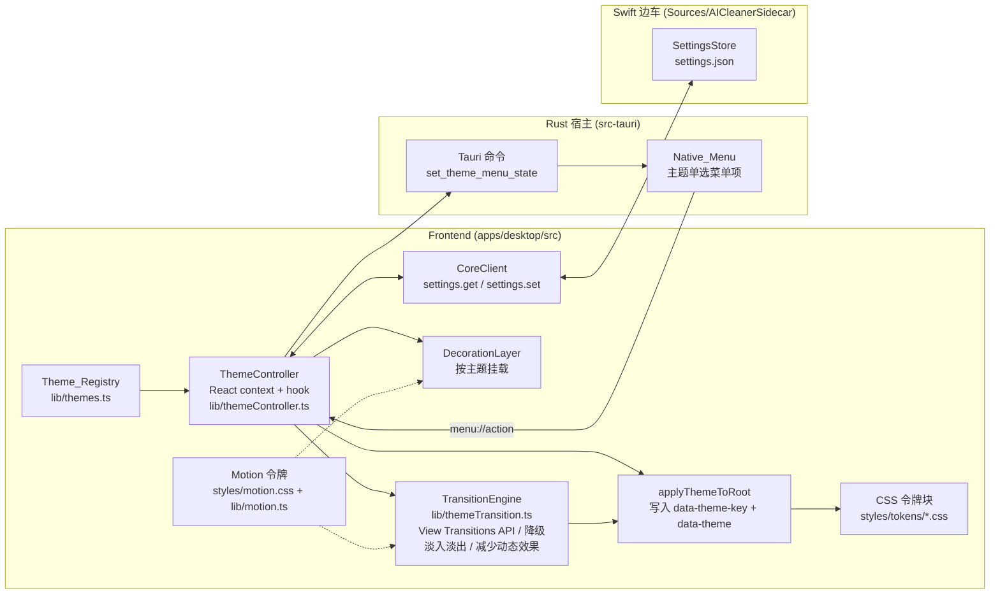

# Design Document

## Overview

本设计覆盖 AI Cleaner 的 Tauri 桌面版：前端位于 `apps/desktop`（React 19 + Vite + TypeScript），Rust 宿主位于 `apps/desktop/src-tauri`，Swift 边车 `aicleaner-core` 位于 `Sources/AICleanerSidecar`。旧版 SwiftUI 应用 `Sources/AICleanerApp` 不做任何修改（需求 12.2）。

本设计实现四个目标：

1. 分层主题令牌（Base_Palette → Semantic_Token → Component_Usage）加主题注册表 Theme_Registry，并优化“浅色磨砂”和“深色极光”两个默认主题（需求 1、2）。
2. 新增仅深色的 Kiroween 主题，包含装饰层与季节性试用邀请对话框（需求 6、7）。
3. 基于 View Transitions API 的主题切换过渡（含降级方案），以及全应用统一的动效体系 Motion_System（需求 8、9、10）。
4. 修复在 1200×780 与 Minimum_Window 下发现的布局问题（需求 11）。

关键设计决策：

- 根元素同时设置两个属性：`data-theme-key`（`light | dark | kiroween`，选择具体主题的令牌块）和 `data-theme`（`light | dark`，表示 Effective_Scheme，供现有样式与 `color-scheme` 使用）。两个属性在同一次同步调用中写入，避免出现中间状态。
- `settings.set` 改为部分补丁语义，参数为 `{ appearanceMode?, themeId?, seasonalPromptYear? }`，只更新传入的字段，未传字段保持原值。
- 默认外观为 `system`，即跟随操作系统明暗。
- 首帧渲染最多等待 1 秒读取设置；超时或读取失败时回退到默认外观继续启动。
- 动效只遵循操作系统的 `prefers-reduced-motion`，应用内不提供单独的动效开关。

## Architecture



数据流说明：ThemeController 从 Theme_Registry 读取主题定义，结合 Appearance_Mode、Theme_Id 与系统明暗解析出当前主题；切换时交给 TransitionEngine 包裹 `applyThemeToRoot` 执行过渡；同时通过 CoreClient 把补丁写回边车，并调用 `set_theme_menu_state` 同步原生菜单的选中状态。原生菜单的点击通过 `menu://action` 事件回到 ThemeController。

### 新增与修改的模块

路径均相对于 `apps/desktop/src`，另有标注的除外。

| 类型 | 路径 | 用途 |
| --- | --- | --- |
| 新增 | `lib/themes.ts` | Theme_Registry：主题 id、显示名称、色彩方案、调色板、Logo 变体、装饰层与过渡定义 |
| 新增 | `lib/themeController.ts` | 主题状态、解析、持久化与菜单同步的 React context 和 hook |
| 新增 | `lib/themeTransition.ts` | 主题切换过渡引擎，含 View Transitions API、降级淡入淡出与减少动态效果分支 |
| 新增 | `lib/season.ts` | Halloween_Season 判定与季节邀请的年份逻辑 |
| 新增 | `lib/motion.ts` | 动效时长与缓动令牌的 TS 常量及 reduced-motion 查询 |
| 新增 | `lib/pathEllipsis.ts` | 路径中间省略算法 |
| 新增 | `components/ThemePanel.tsx` | 以 Preview_Card 展示可选主题的主题选择面板 |
| 新增 | `components/SeasonalInvitationDialog.tsx` | Kiroween 季节试用邀请模态对话框 |
| 新增 | `components/decorations/KiroweenDecorations.tsx` | Kiroween 装饰层（幽灵、蛛网、薄雾、蝙蝠） |
| 新增 | `components/Presence.tsx` | 统一的进入/退出动画包装组件 |
| 新增 | `components/CountUp.tsx` | 数值滚动动画组件 |
| 新增 | `components/MiddleEllipsisPath.tsx` | 使用中间省略显示长路径 |
| 新增 | `styles/tokens.css` | 分层令牌入口，按 `data-theme-key` 定义各主题令牌块 |
| 新增 | `styles/motion.css` | 动效时长、缓动令牌与 reduced-motion 降级规则 |
| 修改 | `App.tsx` | 接入 ThemeController、装饰层、季节邀请与布局调整 |
| 修改 | `main.tsx` | 启动时等待设置（最多 1 秒）后再首帧渲染 |
| 修改 | `components/Toolbar.tsx` | 用 ThemePanel 取代原主题循环按钮 |
| 修改 | `lib/theme.ts` | 推荐等级色、分类色、客户端强调色改为引用 Semantic_Token |
| 修改 | `lib/format.ts` | 配合路径省略与数值格式化的调整 |
| 修改 | `rpc/types.ts` | 新增 `themeId`、`seasonalPromptYear` 字段与部分补丁类型 |
| 修改 | `rpc/client.ts` | `settings.set` 改为发送部分补丁 |
| 修改 | `styles/app.css` 及使用硬编码颜色的组件 | 把硬编码 hex/rgba 替换为令牌引用 |
| 修改 | `apps/desktop/src-tauri/src/menu.rs` | 原生菜单增加主题单选项 |
| 修改 | `apps/desktop/src-tauri/src/lib.rs` | 注册 `set_theme_menu_state` 命令 |
| 修改 | `Sources/AICleanerSidecar/SettingsStore.swift` | 持久化 `themeId`、`seasonalPromptYear`，支持部分更新 |
| 修改 | `Sources/AICleanerSidecar/SidecarServer.swift` | `settings.get` / `settings.set` 处理新字段与补丁语义 |
| 修改 | `protocol/rpc-v1.schema.json` | 协议 schema 增加新的可选字段 |
| 修改 | `App.test.tsx`、`Toolbar.test.tsx`、`e2e/desktop.e2e.spec.ts`、`SidecarFlowTests.swift` | 覆盖新主题、面板、过渡与设置持久化行为 |
| 修改 | `docs/tauri-parity-checklist.md` | 更新与旧版应用的功能对照 |
| 修改 | `CHANGELOG.md` | 记录本特性变更 |

## Components and Interfaces

### Token System

对应需求 1、2.7、2.8、2.11。

**三层结构**（1.1、1.2、1.4–1.6）：

| 层 | 命名 | 定义位置 | 可被谁引用 |
| --- | --- | --- | --- |
| Base_Palette | `--p-*`（每个主题一套原始色值） | `styles/tokens.css` 各主题块 | 仅 Semantic_Token |
| Semantic_Token | 见下表 | `styles/tokens.css` 各主题块 | 组件 CSS、`lib/theme.ts` |
| Component_Usage | 组件样式 | `styles/app.css` 及组件 | 只能引用 Semantic_Token |

Semantic_Token 清单：

| 用途 | 令牌 |
| --- | --- |
| 表面层级 | `--surface-0`、`--surface-1`、`--surface-2`、`--surface-3` |
| 文本 | `--text-primary`、`--text-secondary`、`--text-tertiary` |
| 边框与分隔 | `--border-subtle`、`--border-rim`、`--divider` |
| 推荐等级 | `--fill-{recommended,review,risk,excluded,link}`、`--text-{recommended,review,risk,excluded,link}` |
| 分类色 | `--cat-{sessions,cache,temporary,logs,custom,protectedData}` |
| 客户端强调色 | `--client-accent-<token>`，每个客户端强调色令牌一个 |
| 图表 | `--chart-1` … `--chart-4` |
| 交互 | `--focus-ring`、`--scrollbar-thumb`、`--scrollbar-thumb-hover`、`--selection-bg` |
| 品牌与危险操作 | `--brand-gradient`、`--brand-on`、`--brand-glow`、`--danger-gradient`、`--danger-on` |
| 背景氛围 | `--orb-*`、`--aurora-a`、`--aurora-b`、`--aurora-c`、`--aurora-opacity`、`--backdrop` |
| 阴影 | 阴影令牌（如 `--shadow-card`、`--shadow-popover`） |

**主题块选择**（1.3）：`styles/tokens.css` 中每个主题一个块，选择器为 `:root[data-theme-key='light']`、`:root[data-theme-key='dark']`、`:root[data-theme-key='kiroween']`。`data-theme` 仍取 `'light' | 'dark'`，用于 `color-scheme` 和 Logo 变体。`applyThemeToRoot(resolved)` 在同一个同步函数内依次写入 `root.dataset.themeKey` 与 `root.dataset.theme`，两者之间没有 `await`，浏览器不会渲染出两个属性不一致的帧。

**JS/SVG 颜色**（1.7）：`lib/theme.ts` 中的映射表改为返回 `var(--token)` 字符串，例如 `RECOMMENDATION_FILL.recommended = 'var(--fill-recommended)'`。SVG 的 `stroke`/`fill` 以及 `color-mix(in srgb, var(--cat-logs) 14%, transparent)` 这类表达式随根元素令牌变化自动更新，切换主题不需要重新渲染 React 组件。`clientAccentById(id)` 返回 `var(--client-accent-<token>)`。

**主题注册表**（1.9、1.10）：`lib/themes.ts` 导出：

```ts
interface ThemeDefinition {
  id: string;                      // 注册表条目 id
  key: ThemeKey;                   // 'light' | 'dark' | 'kiroween'，写入 data-theme-key
  label: string;
  scheme: 'light' | 'dark';        // 写入 data-theme
  preview: { canvas: string; sidebar: string; card: string; accent: string; accentAlt: string };
  decoration?: ComponentType;      // 装饰层组件，仅 Kiroween 提供
  transitionIn: TransitionSpec;
  transitionOut: TransitionSpec;
  seasonal?: SeasonalSpec;         // 季节性主题的时间窗口，见 Seasonal Invitation
}
```

`THEME_OPTIONS` 由注册表派生，ThemePanel 只遍历 `THEME_OPTIONS` 渲染 Preview_Card。新增主题只需在注册表加一项并在 `tokens.css` 加一个令牌块，面板与菜单无需改动。

**焦点、选区与滚动条**（2.7、2.8、2.11）：

```css
:focus-visible { outline: 2px solid var(--focus-ring); outline-offset: 2px; }
:focus:not(:focus-visible) { outline: none; }
::selection { background: var(--selection-bg); }
```

滚动条滑块使用 `--scrollbar-thumb`，悬停时使用 `--scrollbar-thumb-hover`。

**硬编码颜色迁移**（1.8）：以下位置的字面量颜色替换为令牌引用。

| 文件 | 需替换的颜色 | 替换为 |
| --- | --- | --- |
| `App.tsx` | `activeAccent` 中的 `'#3db8fa'`、`'#29cc99'` | 客户端强调色 / 品牌令牌 |
| `components/Sidebar.tsx` | 图块底色 `'#29cc99'`、`'#3db8fa'`、`'#14b8a6'` | `--cat-*` / `--client-accent-*` |
| `components/ClientLogo.tsx` | `'#14b8a6'` | `--client-accent-<token>` |
| `components/BottomActionBar.tsx` | rgba 边框与徽标色 | `--border-*`、`--fill-*` |
| `components/TrashConfirmationModal.tsx` | 约 13 处 hex/rgba | `--surface-*`、`--danger-*`、`--text-*` |
| `components/AddCustomDirectoryModal.tsx` | 4 处 | `--surface-*`、`--border-*` |
| `components/OrbitalScannerHero.tsx` | 渐变与 `'#ffffff'` | `--brand-gradient`、`--brand-on` |
| `components/VirtualizedItemList.tsx` | rgba 徽标色 | `--fill-*`、`--text-*` |
| `views/CleanupHistoryView.tsx` | 图表 `'#29d18a'`、`'#3db8fa'`、`'#9980fa'` | `--chart-1..3` |
| `views/ExcludedItemsView.tsx` | `rgba(143,128,245,…)` | `--fill-excluded` |
| `views/ProjectSessionsView.tsx` | `rgba(59,130,246,…)` | `--fill-link` |

防回归测试 `no-raw-colors.test.ts`（vitest）读取 `src/components/**`、`src/views/**` 和 `src/App.tsx` 的源码，用正则匹配 `#[0-9a-fA-F]{3,8}\b` 与 `rgba?\(`，出现字面量即失败。白名单只包括 `#fff`、`#000` 和用于阴影的 `transparent`/黑色 rgba。

### Palettes and Contrast

对应需求 2.1–2.6、2.12、6.2–6.5、13.1。

Light_Theme 与 Dark_Theme 作为一对重新设计，下表列出的每一组前景/背景组合都重新验证（2.12）。`--fill-*` 用于圆点、进度条、图表描边和复选框底色；文本一律使用 `--text-*`（2.6）。阈值：普通文本 4.5:1；图标、非文本 UI 与大号文本 3:1（2.3、2.4）。Kiroween 的品牌紫 `#9046ff` 只用作填充色。

以下对比度均按 WCAG 相对亮度公式计算。

**表面色**：

| 主题 | 表面 | 取值 |
| --- | --- | --- |
| light | canvas | `#f2f4f9` |
| light | card | `#ffffff` |
| light | 选中行（recommended / review / risk） | `#ecfaf3` / `#fdf5e8` / `#fdeef1` |
| dark | canvas / card / elevated（三级，1.6） | `#0b0d13` / `#1a1e29` / `#1d212d` |
| dark | 选中行（recommended / review / risk） | `#13281f` / `#2a2116` / `#2b1a20` |
| kiroween | canvas / card / elevated | `#0c0814` / `#1f1530` / `#221735` |

**Light 文本与分类色**（阈值 4.5，背景依次为 canvas `#f2f4f9` / card `#ffffff` / 选中行 `#ecfaf3`）：

| 令牌 | 取值 | canvas | card | 选中行 | 结果 |
| --- | --- | --- | --- | --- | --- |
| `--text-primary` | `#0f172a` | 16.22 | 17.85 | 16.61 | 通过 |
| `--text-secondary` | `#4a5568` | 6.84 | 7.53 | 7.00 | 通过 |
| `--text-tertiary` | `#5f6d82` | 4.78 | 5.25 | 4.89 | 通过 |
| `--text-recommended` | `#047857` | 4.98 | 5.48 | 5.10 | 通过 |
| `--text-review` | `#b45309` | 4.56 | 5.02 | 4.67 | 通过 |
| `--text-risk` | `#c53048` | 4.91 | 5.40 | 5.02 | 通过 |
| `--text-excluded` | `#6a55e0` | 4.78 | 5.27 | 4.90 | 通过 |
| `--text-link` | `#2563eb` | 4.70 | 5.17 | 4.81 | 通过 |
| `--cat-sessions` | `#5b54e8` | 4.92 | 5.41 | 5.04 | 通过 |
| `--cat-cache` | `#1a66c9` | 5.04 | 5.54 | 5.16 | 通过 |
| `--cat-temporary` | `#b45309` | 4.56 | 5.02 | 4.67 | 通过 |
| `--cat-logs` | `#8b3fd9` | 5.01 | 5.51 | 5.13 | 通过 |
| `--cat-custom` | `#0f766e` | 4.97 | 5.47 | 5.09 | 通过 |
| `--cat-protectedData` | `#be3455` | 5.01 | 5.51 | 5.12 | 通过 |

**Light 非文本填充**（阈值 3.0，背景依次为 canvas / card / `#ecfaf3` / `#fdf5e8`）：

| 令牌 | 取值 | canvas | card | `#ecfaf3` | `#fdf5e8` | 结果 |
| --- | --- | --- | --- | --- | --- | --- |
| `--fill-recommended` | `#059669` | 3.42 | 3.77 | 3.51 | 3.48 | 通过 |
| `--fill-review` | `#c26a05` | 3.56 | 3.92 | 3.65 | 3.62 | 通过 |
| `--fill-risk` | `#e25668` | 3.31 | 3.64 | 3.39 | 3.37 | 通过 |
| `--focus-ring` | `#2563eb` | 4.70 | 5.17 | 4.81 | — | 通过 |

**Light 按钮**：白字在品牌渐变 `#047857 → #0e7490` 两端分别为 5.48 与 5.36；白字在危险渐变 `#c9243f → #b91c3c` 两端分别为 5.52 与 6.37。均通过。

**Light 改值原因**（被淘汰的旧值）：

| 旧值 | 对比度 | 问题 |
| --- | --- | --- |
| 旧 `--cat-cache` `#1d6fd6`（canvas 上） | 4.44 | 低于文本阈值 4.5 |
| 填充 `#10b981` | 2.31 | 低于非文本阈值 3.0 |
| 填充 `#d97706` | 2.90 | 低于非文本阈值 3.0 |
| 旧主色 `#1fdb94` | 1.81 | 低于非文本阈值 3.0 |
| `#0c9466` | 3.86 | 低于文本阈值 4.5 |

**Dark 文本、分类色与焦点环**（背景依次为 canvas `#0b0d13` / card `#1a1e29` / elevated `#1d212d`）：

| 令牌 | 取值 | canvas | card | elevated | 结果 |
| --- | --- | --- | --- | --- | --- |
| `--text-primary` | `#f1f5f9` | 17.73 | 15.19 | 14.66 | 通过 |
| `--text-secondary` | `#a3afc2` | 8.76 | 7.50 | 7.24 | 通过 |
| `--text-tertiary` | `#8592a8` | 6.17 | 5.29 | 5.10 | 通过 |
| `--text-recommended` | `#34d399` | 10.10 | 8.66 | 8.35 | 通过 |
| `--text-review` | `#fbbf24` | 11.63 | 9.97 | 9.62 | 通过 |
| `--text-risk` | `#f87185` | 7.11 | 6.10 | 5.88 | 通过 |
| `--text-excluded` | `#a594ff` | 7.66 | 6.56 | 6.33 | 通过 |
| `--text-link` | `#7cb6ff` | 9.24 | 7.92 | 7.64 | 通过 |
| `--cat-sessions` | `#8f8bff` | 6.76 | 5.79 | 5.59 | 通过 |
| `--cat-cache` | `#56b6ff` | 8.82 | 7.55 | 7.29 | 通过 |
| `--cat-temporary` | `#fbb04a` | 10.55 | 9.04 | 8.73 | 通过 |
| `--cat-logs` | `#c792ff` | 8.31 | 7.12 | 6.87 | 通过 |
| `--cat-custom` | `#3ddbc8` | 11.25 | 9.64 | 9.30 | 通过 |
| `--cat-protectedData` | `#f0889a` | 8.04 | 6.89 | 6.65 | 通过 |
| `--focus-ring` | `#60a5fa` | 7.64 | 6.55 | 6.32 | 通过 |

Dark 的 `--fill-*` 与对应的 `--text-*` 取值相同。按钮：`--brand-on` `#03241a` 在品牌渐变 `#34e8a6` 上为 10.42，在 `#22c3d6` 上为 7.75；白字在危险渐变 `#c9243f` / `#b91c3c` 上为 5.52 / 6.37。

**Kiroween 文本、分类色与焦点环**（背景依次为 canvas `#0c0814` / card `#1f1530` / elevated `#221735`）：

| 令牌 | 取值 | canvas | card | elevated | 结果 |
| --- | --- | --- | --- | --- | --- |
| `--text-primary` | `#f1eaff` | 16.93 | 14.86 | 14.46 | 通过 |
| `--text-secondary` | `#bcaedb` | 9.63 | 8.46 | 8.23 | 通过 |
| `--text-tertiary` | `#9182b3` | 5.70 | 5.01 | 4.87 | 通过 |
| `--text-recommended`（幽灵绿） | `#6ef2a0` | 14.02 | 12.31 | 11.97 | 通过 |
| `--text-review`（南瓜橙） | `#ff9a3c` | 9.37 | 8.23 | 8.00 | 通过 |
| `--text-risk`（血红） | `#ff6f8a` | 7.44 | 6.53 | 6.35 | 通过 |
| `--text-excluded` | `#c3a1ff` | 9.30 | 8.16 | 7.94 | 通过 |
| `--text-link` | `#c9a6ff` | 9.79 | 8.59 | 8.36 | 通过 |
| `--cat-sessions` | `#b083ff` | 7.11 | 6.24 | 6.07 | 通过 |
| `--cat-cache` | `#7ad7ff` | 12.25 | 10.75 | 10.46 | 通过 |
| `--cat-temporary` | `#ff9a3c` | 9.37 | 8.23 | 8.00 | 通过 |
| `--cat-logs` | `#e08cff` | 8.83 | 7.75 | 7.54 | 通过 |
| `--cat-custom` | `#6ef2c0` | 14.26 | 12.52 | 12.18 | 通过 |
| `--cat-protectedData` | `#ff6f8a` | 7.44 | 6.53 | 6.35 | 通过 |
| `--focus-ring` | `#b083ff` | 7.11 | 6.24 | 6.07 | 通过 |
| 品牌紫（作为文本） | `#9046ff` | 4.25 | 3.73 | 3.63 | 不通过 |

品牌紫 `#9046ff` 作为文本不达标，因此只用作填充：品牌渐变、徽记、`--chart-1` 和光晕。按钮：白字在品牌渐变 `#7a2df5 → #9046ff` 两端分别为 5.96 与 4.66；白字在危险渐变 `#c2410c → #c81e45` 两端分别为 5.18 与 5.63。

**Kiroween 语义映射**（6.3）：recommended 为幽灵绿，review 为南瓜橙，risk 为血红。

**图表色**（6.5）：

| 主题 | `--chart-1` | `--chart-2` | `--chart-3` |
| --- | --- | --- | --- |
| light | `#059669` | `#0ea5e9` | `#8b7cf6` |
| dark | `#34d399` | `#38bdf8` | `#a594ff` |
| kiroween | `#9046ff` | `#ff9a3c` | `#6ef2a0` |

Kiroween 的三种图表色色相彼此区分。

**客户端强调色**：每个 `--client-accent-<token>` 保留客户端品牌色相，只用于圆点和 Logo 着色（填充用途，按图标阈值 3:1）。组件需要以文本显示客户端强调色的地方改用 `--text-secondary`。

**验证**：上述对比度表作为测试数据写入 `lib/contrast.test.ts`。该测试解析 `styles/tokens.css`，对每一组声明的前景/背景组合断言达到阈值（见 Correctness Properties 中的 Property 7）。

**装饰层与对比度**（6.13）：Decoration_Layer 的元素不会以降低对比度的不透明度叠在文本后面。薄雾限制在列表内边距以下的底部 120 px 内；蛛网放在画布角落，位于卡片之外。

### Theme State and Resolution

对应需求 4。

**状态**：

```ts
type ThemeId = 'default' | 'kiroween';
type AppearanceMode = 'light' | 'dark' | 'system';
interface ThemeState { themeId: ThemeId; appearanceMode: AppearanceMode; systemDark: boolean }
```

**解析**（4.2、4.3）：两个纯函数，不读取任何全局状态。

```ts
resolveTheme(themeId, mode, systemDark): { key: 'light' | 'dark' | 'kiroween'; scheme: 'light' | 'dark' }
choiceOf(state): 'light' | 'dark' | 'system' | 'kiroween'
```

| themeId | appearanceMode | systemDark | resolveTheme 结果 | choiceOf 结果 |
| --- | --- | --- | --- | --- |
| `kiroween` | 任意 | 任意 | `{ key: 'kiroween', scheme: 'dark' }` | `kiroween` |
| `default` | `light` | 任意 | `{ key: 'light', scheme: 'light' }` | `light` |
| `default` | `dark` | 任意 | `{ key: 'dark', scheme: 'dark' }` | `dark` |
| `default` | `system` | `false` | `{ key: 'light', scheme: 'light' }` | `system` |
| `default` | `system` | `true` | `{ key: 'dark', scheme: 'dark' }` | `system` |

ThemePanel 和 Native_Menu 都用 `choiceOf` 决定选中项。

**选择操作**（4.1、4.4、4.5）：

- 选择 Kiroween：只把 `themeId` 设为 `'kiroween'`，`appearanceMode` 保持不变。
- 选择 浅色 / 深色 / 跟随系统：把 `themeId` 设为 `'default'`，并把 `appearanceMode` 设为所选值。
- 从 Kiroween 选择浅色 / 深色 / 跟随系统时，按上一条应用所选项（4.4）。
- Kiroween 期间 `appearanceMode` 从不被改写，且 `themeId` 与 `appearanceMode` 都持久化到边车。因此即使中途重启，只把 `themeId` 改回 `'default'` 也会得到进入 Kiroween 之前的外观（4.5）。

**系统明暗监听**（4.6–4.8）：ThemeController 订阅 `matchMedia('(prefers-color-scheme: dark)')` 的 `change` 事件，在事件回调中同步更新 `systemDark`。

- `themeId === 'default'` 且 `appearanceMode === 'system'`：立即重新解析，交给 TransitionEngine 执行圆形揭示过渡（不支持时降级淡入淡出，减少动态效果时瞬时切换）。这条路径从不使用 Kiroween 的进入/退出编排。整个处理在事件回调内同步启动，远低于 500 ms 的上限。
- `themeId === 'kiroween'`：只更新 `systemDark`，`resolveTheme` 结果不变，界面不发生任何变化。之后用户离开 Kiroween 且模式为 `system` 时，使用最新的 `systemDark`。
- `appearanceMode` 为 `light` 或 `dark`：只更新 `systemDark`，界面不变。

### Settings Persistence and RPC

对应需求 5.1–5.13、12.3、12.5。

**Swift 边车模型**（5.1–5.5）：

```swift
enum ThemeID: String, Codable { case `default`, kiroween }

struct SidecarSettings: Codable, Equatable {
    var appearanceMode: AppearanceMode
    var themeId: ThemeID = .default
    var seasonalPromptYear: Int?
}
```

自定义 `init(from:)`：

- `themeId` 先按可选 `String` 解码，缺失或不属于 `ThemeID` 的值映射为 `.default`。
- `seasonalPromptYear` 缺失时为 `nil`，表示尚未显示过邀请。
- 这两种情况都不抛错，因此旧版本或更新版本写出的文件不会被判定为存储损坏。

`encode(to:)` 写出全部三个字段。解码对文件宽松，RPC 入参则严格校验（见下文）。

**SettingsStore**（5.6、5.8–5.11）：

- `load()` 的读取顺序：已保存的 Settings_File → 旧版应用存于 UserDefaults 的外观偏好 → `.system`。前两种来源存在时保留其 `appearanceMode`。
- `update(appearanceMode:themeId:seasonalPromptYear:)` 的参数都是可选的。它先 `load()`，只覆盖传入的字段，再用现有的 `.atomic` 写入保存。

**RPC `settings.set`**（5.9、5.10）：参数改为部分补丁。

| 输入 | 结果 |
| --- | --- |
| 不含任何已知字段 | `-32602` |
| `themeId` 不是 `default` / `kiroween` | `-32602` |
| `seasonalPromptYear` 不是 2000…9999 的整数 | `-32602` |
| `appearanceMode` 不是 `light` / `dark` / `system` | `-32602` |
| 旧版前端只发送 `{ appearanceMode }` | 接受，保留已存储的 `themeId` 与 `seasonalPromptYear` |
| 合法补丁 | 合并后原子写入，返回合并后的完整设置 |

`settings.get` 返回全部三个字段，`seasonalPromptYear` 可以为 `null`。

**TypeScript 类型**（5.4）：

```ts
type ThemeId = 'default' | 'kiroween';
interface SettingsDTO {
  appearanceMode: AppearanceMode;
  themeId?: ThemeId;                  // 旧版边车不返回
  seasonalPromptYear?: number | null; // 旧版边车不返回
}
type SettingsPatch = Partial<{ appearanceMode: AppearanceMode; themeId: ThemeId; seasonalPromptYear: number }>;
CoreClient.setSettings(patch: SettingsPatch): Promise<SettingsDTO>;
```

前端读取设置时把缺失或未知的 `themeId` 规范化为 `'default'`。

**协议 schema**（5.12、12.3）：`protocol/rpc-v1.schema.json` 中的方法名不变。新增：

- `$defs/settingsSetParams`：`type: object`，可选属性 `appearanceMode`（enum）、`themeId`（enum）、`seasonalPromptYear`（integer，2000–9999），`minProperties: 1`，`additionalProperties: false`。
- 在 `request.allOf` 中按 `items.query` 的写法增加一条 `if: { method: const "settings.set" }` → `then: { required: ["params"], params: $ref settingsSetParams }`。
- `$defs/settingsDTO`：`appearanceMode` 必填，`themeId`、`seasonalPromptYear`（integer 或 null）可选。
- 同步更新 `protocol/fixtures/rpc-v1-samples.json`，加入部分补丁、旧版 `{ appearanceMode }` 调用和包含新字段的 `settings.get` 响应样例。

**测试**（5.13、12.5，细节见 Testing Strategy）：`SidecarFlowTests.swift` 中的 XCTest 覆盖：无文件时默认为 `system`；旧版外观偏好被保留；文件中出现未知 `themeId`；文件缺少新字段；部分补丁保留其他字段；非法参数返回 `-32602`；设置读写往返一致。

### Boot Sequence

对应需求 5.14、5.15、5.16。

**首帧背景**（5.14）：`index.html` 增加内联样式：

```css
html { background: #f2f4f9 }
@media (prefers-color-scheme: dark) { html { background: #0b0d13 } }
#root { visibility: hidden }  /* 就绪后移除 */
```

在设置就绪之前 `#root` 保持隐藏，窗口只显示与操作系统明暗一致的中性背景，不会先闪出一个错误的已保存主题。macOS 上窗口是透明的，此时 `html` 背景为 transparent，只有侧边栏和画布的令牌生效，因此隐藏的 `#root` 下方显示原生 vibrancy 效果。

**bootTheme**（5.15）：`main.tsx` / `App` 在渲染应用树之前执行 `bootTheme(core)`：

```ts
async function bootTheme(core: CoreClient): Promise<{ bootFallback: boolean }> {
  // 1. await core.handshake()
  // 2. core.getSettings() 与 1000 ms 计时器竞速
  // 成功：applyThemeToRoot(resolveTheme(...))，不带过渡，然后渲染
  // 超时或出错：应用 default 主题 + system 模式，bootFallback = true，然后渲染
}
```

- 成功：用 `applyThemeToRoot` 直接应用已保存的主题，不播放过渡，然后渲染。
- 超时或出错：应用 `default` 主题和 `system` 模式，标记 `bootFallback = true`，然后渲染。
- 其余启动加载（清理历史、排除项、自定义目录、磁盘信息）保持现有的 `Promise.allSettled`，在首帧绘制之后执行。现有的握手失败横幅路径不变。

**设置迟到**（5.16）：如果设置在回退之后才返回，ThemeController 调用与用户选择相同的 `selectTheme(choice, { origin: center, source: 'boot' })` 路径。因此过渡规则照常适用（圆形揭示、Kiroween 召唤、降级淡入淡出，Reduced_Motion 下瞬时切换）。`source: 'boot'` 时不发送 `settings.set`，避免把刚读到的值写回。

**测试**：使用 vitest 假计时器和 mock transport 覆盖以下情形。

| 情形 | 预期 |
| --- | --- |
| 设置在 10 ms 返回 | 应用已保存主题，无过渡 |
| 设置永不返回 | 1000 ms 时回退到默认主题 |
| 设置在 1500 ms 返回 | 先回退，再走正常切换路径，不回写设置 |
| 设置读取被拒绝 | 回退到默认主题 |

HTTP 桥（e2e）与 Tauri 使用相同的 CoreClient 路径。

### Theme Transition Engine

对应需求 8、3.6、3.13、4.8、13.2。

**控制器 API**：`lib/themeController.ts` 通过 `ThemeProvider` context 暴露：

```ts
selectTheme(choice: ThemeChoice, opts: { origin?: { x: number; y: number };
  source: 'panel' | 'menu' | 'invitation' | 'system' | 'boot' }): void
```

执行顺序：

1. 计算下一个 ThemeState 并用 `resolveTheme` 得到目标主题。
2. 用 `transitionKindBetween(fromKey, toKey)` 选择过渡类型：`light ↔ dark` 为 `'circle'`；进入 `kiroween` 为 `'summon'`；离开 `kiroween` 为 `'dawn'`；key 相同则不过渡。`source: 'system'` 只会产生 `'circle'`（4.8）。
3. 调用 `runThemeTransition({ kind, origin, commit })`。
4. 乐观地通过 `settings.set` 持久化。持久化失败时记录日志并保留已应用的主题，下次启动恢复已持久化的值（3.6、3.13）。`source: 'boot'` 时不发送（5.16）。

**commit**：在 View Transition 的 update 回调内命令式调用 `applyThemeToRoot(resolved)`（同步写入两个属性，1.3），并在同一回调中用 `flushSync` 更新 React 状态，使依赖 `data-theme` 的 Logo 变体和其他随主题变化的组件在新帧中完成渲染。原因：浏览器在回调返回后捕获新快照，此时 DOM 必须已是最终状态。

**View Transitions 路径**（8.1）：

- 特性检测：`typeof document.startViewTransition === 'function'`。
- 过渡期间根元素带 `data-theme-transition`，以下 CSS 关闭 UA 默认动画：

```css
html[data-theme-transition]::view-transition-old(root),
html[data-theme-transition]::view-transition-new(root) { animation: none; mix-blend-mode: normal; }
html[data-theme-transition]::view-transition-group(root) { animation-duration: 0s; }
```

- macOS 窗口透明，过渡期间根元素临时使用不透明的 `--canvas-bg` 背景，避免快照透底。
- 动画由 `document.documentElement.animate(keyframes, { pseudoElement: '::view-transition-new(root)' })`（及 `-old`）驱动。

**编排即数据**：每种过渡是一组定时阶段 `{ name, start, end, target: 'old' | 'new' | 'fx' }`。运行前由 `validatePhases()` 校验：阶段按声明顺序排列；要求先后顺序的阶段不重叠；总时长不超过预算。校验失败视为执行错误（8.13 → 8.11）。

| 类型 | 总时长 | 阶段 |
| --- | --- | --- |
| `circle`（8.2） | 680 ms（预算 600–700） | 新快照 `clip-path: circle(0 at x y)` → `circle(R at x y)`，R 为原点到最远角的距离；FX 光环（固定定位 div，`view-transition-name: theme-fx`）沿边缘缩放，带主题的 `--fx-ring` 光晕；旧快照轻微缩放至 0.985 并变暗 |
| `summon`（8.3） | 1400 ms | flicker 0–120 ms：旧快照亮度闪烁；flight 120–700 ms：幽灵精灵（FX 层内联 SVG）从原点飞向中心；engulf 700–1400 ms：新快照 `mask-image` 为幽灵 SVG data URI，`mask-size` 增大直到幽灵圆顶覆盖视口对角线；700–1300 ms 期间 6–8 只小蝙蝠 SVG 从边缘散开；同时写 `-webkit-mask-*` 以兼容 WebKit |
| `dawn`（8.4、8.13） | 950 ms（上限 1000） | vanish 0–300 ms：幽灵精灵缩小淡出；wipe 300–950 ms：新快照线性渐变遮罩自上而下推进，FX 层带一条浅色日光线。vanish 必须在 wipe 开始前结束 |

**打断**（8.5）：新选择到来时，对进行中的过渡调用 `skipTransition()`，取消其 Web Animations，重置 FX 层，新选择从当前已应用状态开始。只持久化最后一次选择。

**降级**（8.6、8.14）：没有 View Transitions，或 summon/dawn 时 `CSS.supports('mask-image', 'url(x)')` 与 `CSS.supports('-webkit-mask-image', 'url(x)')` 都不成立，则给根元素加 `html.theme-xfade`，对 `background-color`、`color`、`border-color`、`fill`、`stroke` 做 320 ms 过渡，执行 commit，320 ms 后移除该类。所有切换（含 Kiroween）都适用；Kiroween 调色板与 DecorationLayer 照常生效。

**Reduced_Motion**（8.7）：调用时读取 `matchMedia('(prefers-reduced-motion: reduce)')`，命中则瞬时 commit，不创建 FX。

**响应性与清理**（8.8、8.9、8.10、8.11、13.2）：

- 过渡从不等待 RPC。
- FX 层是常驻的空容器，子元素每次运行时创建，在 `finally` 中移除；同时移除 `data-theme-transition`。
- 任一步骤出错（8.11）都回退为瞬时 commit。
- 性能：快照是合成后的图像，5,200 行虚拟列表不会重新布局；只动画 `clip-path`、`mask`、`transform`、`opacity`；令牌切换只触发一次样式重算（13.2）。

**平台说明**（8.12）：WebView2（Chromium）支持 View Transitions；WKWebView 从 Safari 18（macOS 15+）起支持，macOS 14 走降级路径；WebKitGTK 取决于版本，靠特性检测，接受降级。

### Theme Panel and Native Menu

对应需求 3、10。

**ThemePanel**（`components/ThemePanel.tsx`，3.1、3.2、3.12、1.10）：

- 弹出层锚定在工具栏按钮下方。按钮保留 `data-testid="toolbar-appearance"`，标签显示当前选择的名称和图标，带 `aria-haspopup="dialog"` 与 `aria-expanded`。
- 内容为 `role="radiogroup"`，按注册表顺序渲染 `THEME_OPTIONS` 中的 4 张 Preview_Card：浅色磨砂、深色极光、跟随系统、Kiroween。

**键盘与无障碍**（3.5、3.7、3.8、4.3）：

- 每张卡片为 `role="radio"`，带 `aria-checked`，可访问名称为 label + caption。
- 使用 roving tabindex：方向键移动焦点，Enter/Space 选择，Esc 关闭面板并把焦点还给工具栏按钮。
- 选中卡片显示勾选图标和描边，不只依赖颜色区分（3.5）。
- Kiroween 生效时三张外观卡片都不选中，选中项由 `choiceOf` 决定（4.3）。

**Preview_Card 外观与动效**（3.3、3.4、10.1–10.4、9.15、9.16）：

- 用 CSS 按 `preview` 颜色绘制迷你窗口：侧边栏条、两张卡片、强调色圆点和进度条。跟随系统卡片沿对角线拼接浅色和深色预览。
- 悬停或聚焦时在 160 ms 内上浮（`translateY(-2px)` 加阴影，10.1）。
- 卡片的迷你装饰动画只在 `:hover` / `:focus-visible` 时播放：深色为极光光斑漂移，浅色为一道光泽扫过，Kiroween 为幽灵漂浮加一只蝙蝠。Reduced_Motion 或窗口隐藏时暂停（10.3、9.15、9.16）。
- 选择操作从不等待预览动画结束（10.4）。
- 面板进入/退出使用共享的弹出层动效模式（10.2）。

**选择行为**（3.6）：点击卡片调用 `selectTheme(choice, { origin: 卡片中心, source: 'panel' })`，并立即关闭面板。决策理由：关闭面板让过渡在整个窗口上不被遮挡地播放；以卡片中心为原点，圆形揭示从用户点击的位置展开。

**原生菜单**（3.9–3.11）：

- `menu.rs` 用“外观”子菜单替换 `appearance.cycle`，子菜单含 4 个 `CheckMenuItem`，id 为 `theme.light`、`theme.dark`、`theme.system`、`theme.kiroween`，通过现有的 `menu://action` 事件发出。
- `CheckMenuItem` 点击时会自行切换勾选状态。因此 Rust 处理函数立即重新设定唯一勾选项；前端在每次应用选择之后（包括启动时）调用新增的 Tauri 命令 `set_theme_menu_state(choice)`，使单选标记与实际状态一致（3.11）。
- Rust 把 4 个菜单项句柄存入 managed state。
- 在 `capabilities/default.json` 中加入该命令的权限。
- 不在 Tauri 中运行时（HTTP 桥、vitest），对应的 transport 方法为空操作。
- `MenuActionId` 用这 4 个 id 替换 `'appearance.cycle'`。控制器把它们映射为 `selectTheme(choice, { source: 'menu' })`，原点取工具栏按钮中心（3.10）。

**移除**：`lib/format.ts` 中的 `nextAppearanceMode` 及 `App.tsx` 中的循环切换逻辑；`appearanceDisplayName` 改用注册表中的 label。

### Kiroween Theme and Decoration Layer

对应需求 6、13.7。

**调色板与注册项**（6.1–6.6）：调色板和语义映射见“Palettes and Contrast”。注册表中 Kiroween 条目的 `scheme` 只有 `'dark'`（6.1）。`resolveClientLogoSrc` 读取的 `data-theme` 为 `'dark'`，因此使用深色 Logo 变体（6.6）。

**Kiro 幽灵造型**（13.7）：在 `components/decorations/ghost.ts` 中只定义一次内联 SVG 路径：圆顶、带三个波浪的下摆、两只椭圆眼睛。侧边栏幽灵、过渡精灵、遮罩 data URI（不挖眼睛的实心版本）、成功动画幽灵和 Preview_Card 都复用这一路径。不使用位图资源，不发起网络加载。

**KiroweenDecorations**（6.7、6.8、6.12、6.13）：

- 注册为该主题的 `decoration`，只在 `data-theme-key='kiroween'` 生效时挂载。
- 挂载在固定定位的全窗口层上，带 `pointer-events: none` 与 `aria-hidden="true"`。层级高于画布、低于模态框和 Bottom_Dock，且不进入内容卡片（6.12）。

| 元素 | 位置与尺寸 | 动画 | 需求 |
| --- | --- | --- | --- |
| 侧边栏幽灵 | 品牌徽记旁，18 px | 3.2 s 循环漂浮，`translateY` ±3px | 6.7 |
| 蛛网 | 详情区画布右上角，120 px，不透明度 18%，位于卡片之外 | 静态 | 6.8、6.13 |
| 薄雾 | 详情区底部两层宽幅渐变，高度不超过 120 px，位于列表底部内边距之下 | `translateX` 漂移，周期 40 s 与 60 s，不透明度 ≤ 0.35 | 6.8、6.13 |
| 偶现蝙蝠 | 画布顶部区域，单只小蝙蝠 | 每 25–40 s（随机）沿 transform 路径飞过一次 | 6.8 |

**现有组件的主题变体**（6.9–6.11）：通过 `[data-theme-key='kiroween']` 选择器的 CSS 加少量条件渲染的 SVG 实现。

- 扫描就绪光球（6.9）：南瓜灯造型。`--orb-gradient` 提供橙到紫的径向渐变，在现有 Sparkles 图标上叠加雕刻的眼睛和嘴巴 SVG，光晕做缓慢的烛光闪烁。
- 扫描器（6.10）：两条轨道环替换为 3 只蝙蝠，以不同半径和速度绕行。
- 清理成功（6.11）：火花迸发替换为 5–7 只小幽灵，在 1.2 s 内上浮并淡出。

**暂停**（6.14、9.16）：`useWindowVisibility` hook 以 `document.hidden` 为唯一判断依据，监听 `visibilitychange`。窗口失焦不等于不可见，Tauri 的 blur 事件也无法可靠反映遮挡，因此不使用这两者；仅在实测 `document.hidden` 不反映最小化时，再补充 Tauri `onResized` 的最小化检查。窗口隐藏时设置 `html[data-window-hidden]`，CSS 在该属性下对所有装饰和循环动画设置 `animation-play-state: paused`。

**Reduced_Motion**（6.15）：在 `@media (prefers-reduced-motion: reduce)` 下，装饰以静态形式显示，不播放漂浮、薄雾漂移和蝙蝠飞行。成功动画改为单个幽灵图标 100 ms 淡入。

**性能**（13.3、13.8）：所有循环动画只动画 `transform` 与 `opacity`，且只作用于少数提升为合成层的元素。CPU 占用在性能检查中测量并记录，不做自动降级。

### Seasonal Invitation

对应需求 7。

**纯函数**（`lib/season.ts`）：

```ts
// 使用本地时间的 getMonth()/getDate()，10 月 25 日至 12 月 15 日（含两端）为 true（7.2）
isHalloweenSeason(date: Date): boolean

// season && themeId !== 'kiroween' && seasonalPromptYear !== date.getFullYear() && !suppressedThisRun
// （7.1、7.3、7.7、7.8）
shouldOfferInvitation(input: {
  date: Date; themeId: ThemeId; seasonalPromptYear: number | null; suppressedThisRun: boolean;
}): boolean
```

**流程**（由 ThemeController 负责，在启动完成后执行）：

- 启动时用启动日期调用一次 `shouldOfferInvitation`。结果为 true 时，邀请进入 `pending` 状态，并记录启动年份。
- 扫描或清理进行中（`isScanning || isCleaning`）时保持 pending（7.10）。两者都为 false 时立即显示。即使此时季节已结束也照常显示，因为启动时条件已满足（7.13）。
- 在季节外启动从不产生 pending 邀请（7.7）。
- pending 期间用户进入 Kiroween，则丢弃该邀请（7.3）。

**显示时**：立即调用 `settings.set({ seasonalPromptYear: year })`（7.4）。写入失败时设置 `suppressedThisRun = true`，本次运行中不再弹出（7.9）。

**对话框**（`components/SeasonalInvitationDialog.tsx`，7.5、7.6、7.11、7.14）：

- 模态对话框，使用共享的模态框动效模式（9.5、9.6）。
- 无障碍：`role="dialog"`、`aria-modal`、`aria-labelledby` / `aria-describedby`；初始焦点在主按钮上；焦点限制在对话框内；Esc 等同于“以后再说”；关闭后焦点还给打开前的元素（7.11、7.14）。
- 内容：Kiro 幽灵插画、标题“Kiroween 来了”、一句说明文字、按钮“试试 Kiroween”和“以后再说”。
- 接受：调用 `selectTheme('kiroween', { origin: 接受按钮中心, source: 'invitation' })`，播放召唤过渡（7.5）。
- 拒绝：保持当前主题（7.6）。

**全年可选**（7.12）：Kiroween 在主题面板和原生菜单中全年都可选择，不受季节限制。

**测试**：边界日期 10 月 24 日 / 10 月 25 日 / 12 月 15 日 / 12 月 16 日（12.6）；跨年；pending 期间季节结束后仍显示；写入失败后本次运行不再弹出；Kiroween 已生效时不弹出。

### Motion System

对应需求 9、13.4、13.6。

**动效令牌**（9.1–9.3、9.9）：定义在 `styles/motion.css`，`lib/motion.ts` 导出同名 TS 常量。`app.css` 中现有的 140ms / 220ms 字面量全部替换为令牌。

| 令牌 | 取值 | 用途 | 需求 |
| --- | --- | --- | --- |
| `--dur-press` | 90ms | 按下反馈 | 9.2（80–160） |
| `--dur-hover` | 140ms | 悬停反馈 | 9.2（80–160） |
| `--dur-enter` | 220ms | 元素进入 | 9.3（160–320） |
| `--dur-exit` | 160ms | 元素退出 | 9.3 |
| `--dur-view` | 260ms | 视图切换 | 9.3 |
| `--dur-emphasis` | 320ms | 强调动效 | 9.3 |
| `--dur-count` | 600ms | 数值滚动上限 | 9.9 |
| `--ease-standard` | `cubic-bezier(0.2, 0, 0, 1)` | 通用 | |
| `--ease-enter` | `cubic-bezier(0.05, 0.7, 0.1, 1)` | 进入 | |
| `--ease-exit` | `cubic-bezier(0.3, 0, 0.8, 0.15)` | 退出 | |
| `--ease-spring` | `cubic-bezier(0.34, 1.4, 0.64, 1)` | 仅用于按下后的回弹 | |

**Presence 组件**（`components/Presence.tsx`，9.6、9.17、9.18）：

- 子元素保持挂载，并带 `data-state="open" | "closed"`。
- 关闭时等待 `animationend` 后再卸载；同时设置一个等于退出令牌加 50 ms 的超时作为兜底（9.6）。
- 交互从不等待动画：动画进行中再次打开或关闭，立即反转当前状态（9.18）。

共享动效模式（9.17），都使用上表令牌：

| 模式 | 动画 |
| --- | --- |
| 模态框 | 遮罩淡入；面板 `scale(0.96)` → 1，`translateY(8px)` → 0 |
| 弹出层 / 菜单 | `scale(0.98)` 加不透明度，`transform-origin` 取锚点方向 |
| Dock / 提示条 | `translateY(12px)` 加不透明度 |

**侧边栏视图切换**（9.4）：使用带 key 的 CSS 动画，不使用 View Transitions API（该 API 只留给主题切换）。

- 详情内容容器设置 `key={viewKey}`，进入时 260 ms 内 opacity 0 → 1、`translateY(6px)` → 0。
- 不做退出动画，旧视图瞬时替换，保证导航响应快。
- 滚动位置恢复逻辑不变，虚拟列表照旧重新挂载。

**列表行进入与退出**（9.7、9.8、9.13）：

- 列表维护 `listEpoch`。可见集合因筛选、搜索、排除或清理而变化时递增；滚动不递增。
- epoch 变化时，只有此刻已在视口内渲染的行获得 `data-enter`：每行错开 18 ms，最多 8 行，220 ms 淡入加 `translateY(4px)`。之后因滚动挂载的行从不获得该属性。
- 被排除或清理的行播放 160 ms 退出动画：在快照克隆的覆盖层上做 opacity 加 `translateX(8px)`，列表本身直接重新渲染为不含这些行。不做高度动画（9.13）。

**CountUp**（`components/CountUp.tsx`，9.9、9.15）：

- 用 rAF 对显示数值做补间，每帧调用 `formatBytes`。
- 使用 `font-variant-numeric: tabular-nums` 固定数字宽度，避免抖动。
- 时长为 min(600 ms, 按变化幅度计算的值)，缓动为 ease-out。
- Reduced_Motion 下直接跳到目标值。
- 用于 Dashboard_Card（环形图中心与分档数值）和 Bottom_Dock（已选数量与大小）。

**扫描、清理与 Dock**（9.10–9.12）：

- 扫描（9.10）：阶段胶囊状态变化时做 220 ms 的背景色与缩放脉冲。扫描完成后扫描器缩放至 0.96 并在 200 ms 内淡出，结果视图按视图切换模式进入。
- 清理（9.11）：成功提示按 Dock 模式进入，并叠加当前主题的粒子效果；被移除的行按上文退出；CountUp 动画显示减少后的数值。
- Bottom_Dock（9.12）用 Presence 包装。

**属性白名单**（9.13）：动画与过渡只允许作用于：

- `transform`、`opacity`、`clip-path`、`mask` / `-webkit-mask`
- `filter`（仅用于主题切换的闪烁）
- `color` / `background-color`（仅用于悬停反馈和主题降级淡入淡出）

vitest 防回归测试解析 `app.css`、`motion.css`、`tokens.css` 中的 `transition`、`animation` 与 keyframes，出现 `width`、`height`、`top`、`left`、`right`、`bottom`、`margin`、`padding` 即失败。

**Reduced_Motion 与窗口隐藏**（9.15、9.16、9.19）：

- 单个 `@media (prefers-reduced-motion: reduce)` 块把位移类令牌设为 0，进入/退出改为不超过 100 ms 的不透明度淡入淡出。
- 循环动画（轨道、极光、装饰、脉冲）全部停用。
- 应用内不提供动效设置，只遵循操作系统偏好（9.19）。
- 窗口隐藏时，`html[data-window-hidden] *` 暂停所有动画（9.16）。

**性能**（9.14、13.3、13.8）：

- 在现有 5,200 行 e2e 场景中测量。Playwright 在滚动加主题切换期间采样 rAF 帧时间，在具备 CI 能力的运行器上断言平均帧率 ≥ 50 fps；慢速运行器上只报告不断言。
- 手动 CPU 测量流程：Kiroween 生效、空闲 60 s，用活动监视器 / 任务管理器读取 CPU 占用，结果记录在 PR 中。
- 运行时不做自动降级。

### Layout Changes

对应需求 11。以下改动以 Minimum_Window 1020×660（macOS 覆盖式标题栏）为基准。

**Disk_Footer**（11.1）：`height: 82px` 改为 `min-height`，加 `padding: 12px 14px`；`.disk-bar-track { flex-shrink: 0 }`，保证进度条保持 5 px 高度。

**Control_Bar**（11.2、11.3）：

- 所有按钮设置 `white-space: nowrap; flex-shrink: 0`。
- 分类分段控件允许收缩，超出时横向滚动，隐藏滚动条，两端加渐隐遮罩。
- 搜索框为 `flex: 0 1 220px; min-width: 140px`。
- Control_Bar 按详情面板宽度自适应：在 `.detail-content` 上设置 `container-type: inline-size`，用 CSS 容器查询判断，不按窗口宽度判断。侧边栏占 252 px，Minimum_Window 1020 px 下详情面板实测约 768 px，1200 px 窗口下约 948 px。
- 详情面板宽度 ≥ 760 px（包括 Minimum_Window 下的 768 px）：单行完整布局，所有标签可见（11.2）。
- 低于 760 px（只有在系统显示缩放或窗口小于 Minimum_Window 时才会出现）：“项目会话”按钮收起为仅图标，标签保留为 aria-label 和 tooltip。
- 低于 640 px：分类分段控件移入选项菜单中的“分类”分组。
- 任何宽度下控件文字都不会竖向换行（11.3）。
- 不支持容器查询时的回退：依靠上面可收缩的搜索框和可横向滚动的分类控件，仍能避免文字竖向换行。

**路径中间省略**（11.4–11.6）：`components/MiddleEllipsisPath.tsx` 加 `lib/pathEllipsis.ts`。

- 按 `/` 或 `\` 切分路径，保留主目录前缀（`~`）和最后一段，把中间段折叠为 `…`，直到放得下测得的宽度。
- 宽度由 ResizeObserver 测量，文本宽度用 canvas `measureText` 按等宽字体计算，结果按宽度区间缓存。
- 完整路径放在 `title` 和无障碍描述中。
- 安全说明改为路径之后单独的可截断 span。标题行中的标题与锁定/风险徽标设置 `flex-shrink: 0`。

**Bottom_Dock 遮挡**（11.7）：Dock 用 ResizeObserver 测量自身高度，写入详情面板的 `--dock-height`。虚拟列表底部内边距为 `calc(var(--dock-height, 0px) + 28px)`。

**Dashboard_Card**（11.8、11.12）：

| 项 | 修改前 | 修改后 |
| --- | --- | --- |
| HairlineStorageBar 及其 12 px 间距 | 有 | 移除 |
| 内边距 | 14 px | 12 px 14 px |
| 分档条高度 | 52 px | 46 px |
| 外层 padding | 4 / 10 | 2 / 8 |
| 卡片高度 | 约 164 px | 约 128 px |

660 px 高度下的预算：工具栏 48 + Dashboard 约 128 + Control_Bar 40 = 216，列表剩余约 444 px（原约 408 px）。1 个分组标题 38 + 5 行 × 62 = 348，加上 Dock 内边距仍能放下（11.12）。

**行操作按钮**（11.9、11.10）：

- `.row-actions { opacity: 0 }`，在 `.item-row-card:hover`、`:focus-within` 以及已选中的行上显示。
- 按钮始终保留在 DOM 和 Tab 顺序中，键盘聚焦时显示。
- `@media (hover: none)` 下始终可见。

**侧边栏空状态**（11.11）：首次扫描之前，“AI 客户端”分组用 tertiary 文本显示“扫描后将列出检测到的 AI 客户端”。

**Return_To_Scan_Control**（11.16）：从 `btn-subtle-pill` 改为文本样式的幽灵按钮（无边框无背景，`--text-secondary`，带 chevron 图标），放在主操作左侧并额外留 8 px 间距。标签、aria 属性和 `data-testid="return-to-idle-btn"` 不变。

**平台差异**（11.13、11.14）：`:root[data-platform='macos'] .sidebar-header { padding-left: 78px }` 只作用于 macOS；Windows / Linux 使用 14 px。工具栏拖拽区域不变。

**无横向滚动条**（11.15）：`.detail-pane { min-width: 0 }`，列表行 `min-width: 0`，在 1020×660 下验证。

**验证**：Playwright 截图脚本在 1020×660 和 1200×780 两种尺寸下，对 light、dark、kiroween 三个主题分别截取 ready、overview、client、history、excluded 页面。对照清单检查：

- 磁盘进度条可见
- 没有换行的控件文字
- 可见行数 ≥ 5
- 最后一行不被 Dock 遮挡
- 没有横向滚动（以 `scrollWidth <= clientWidth` 判断）

## Data Models

以下类型均已在前文出现，这里集中列出。

**TypeScript（`apps/desktop/src`）**：

```ts
type ThemeId = 'default' | 'kiroween';
type AppearanceMode = 'light' | 'dark' | 'system';
type ThemeChoice = 'light' | 'dark' | 'system' | 'kiroween';
type ThemeKey = 'light' | 'dark' | 'kiroween';

interface ResolvedTheme { key: ThemeKey; scheme: 'light' | 'dark' }

interface ThemeDefinition {
  id: string;
  key: ThemeKey;
  label: string;
  scheme: 'light' | 'dark';
  preview: { canvas: string; sidebar: string; card: string; accent: string; accentAlt: string };
  decoration?: ComponentType;
  transitionIn: TransitionSpec;
  transitionOut: TransitionSpec;
  seasonal?: SeasonalSpec;
}

interface SettingsDTO {
  appearanceMode: AppearanceMode;
  themeId?: ThemeId;
  seasonalPromptYear?: number | null;
}
type SettingsPatch = Partial<{ appearanceMode: AppearanceMode; themeId: ThemeId; seasonalPromptYear: number }>;

type TransitionKind = 'circle' | 'summon' | 'dawn';
interface TransitionPhase { name: string; start: number; end: number; target: 'old' | 'new' | 'fx' }

type InvitationState = 'none' | 'pending' | 'shown' | 'suppressed';

// MenuActionId：移除 'appearance.cycle'，新增
type ThemeMenuActionId = 'theme.light' | 'theme.dark' | 'theme.system' | 'theme.kiroween';
```

**Swift（`Sources/AICleanerSidecar`）**：

```swift
enum ThemeID: String, Codable { case `default`, kiroween }

struct SidecarSettings: Codable, Equatable {
    var appearanceMode: AppearanceMode
    var themeId: ThemeID = .default
    var seasonalPromptYear: Int?
}
```

**settings.json 示例**：

新格式（写出全部三个字段）：

```json
{ "appearanceMode": "system", "themeId": "kiroween", "seasonalPromptYear": 2025 }
```

旧格式（只有 `appearanceMode`，解码为 `themeId = .default`、`seasonalPromptYear = nil`）：

```json
{ "appearanceMode": "dark" }
```

## Correctness Properties

*A property is a characteristic or behavior that should hold true across all valid executions of a system-essentially, a formal statement about what the system should do. Properties serve as the bridge between human-readable specifications and machine-verifiable correctness guarantees.*

属性即在所有合法执行中都应成立的行为陈述，是需求与可机器验证的测试之间的桥梁。

### Property 1: resolveTheme 全定义且 Kiroween 恒为深色

*For any* `(themeId, appearanceMode, systemDark)` 组合，`resolveTheme` 都返回一个合法的 `ResolvedTheme`；当 `themeId === 'kiroween'` 时结果恒为 `{ key: 'kiroween', scheme: 'dark' }`。

**Validates: Requirements 4.2, 6.1, 1.3**

### Property 2: 离开 Kiroween 恢复原外观，Kiroween 期间忽略系统明暗

*For any* 由选择操作（light / dark / system / kiroween）与系统明暗变化组成的随机序列，离开 Kiroween 后的 `appearanceMode` 等于进入 Kiroween 之前生效的值；Kiroween 生效期间，系统明暗变化从不改变解析出的 `key`。

**Validates: Requirements 4.4, 4.5, 4.7**

### Property 3: 设置读写往返与部分补丁

*For any* 合法的 `SidecarSettings` 值，`update` 后 `load` 返回相等的值；*for any* 已存储的值，只含 `appearanceMode` 的补丁不改变 `themeId` 与 `seasonalPromptYear`。

**Validates: Requirements 5.9, 5.10, 5.13**

### Property 4: 宽松解码设置文件

*For any* `themeId` 缺失或为任意字符串、`seasonalPromptYear` 缺失的 settings JSON，解码都成功，得到 `themeId = .default`（合法值除外）与 `seasonalPromptYear = nil`，且不报告存储损坏。

**Validates: Requirements 5.3, 5.4, 5.5**

### Property 5: 季节判定与每年最多一次邀请

*For any* 日期，`isHalloweenSeason` 为 true 当且仅当本地 (月, 日) 落在 10 月 25 日至 12 月 15 日（含两端）；*for any* 跨年份、带任意历史的启动序列，邀请每个日历年最多出现一次，且 Kiroween 生效时从不出现。

**Validates: Requirements 7.1, 7.2, 7.3, 7.7, 7.8**

### Property 6: 令牌完整性

*For any* `tokens.css` 中的主题块，其声明的 Semantic_Token 名称集合与其他所有主题块完全相同。

**Validates: Requirements 1.2, 1.4**

### Property 7: 对比度达标

*For any* 主题中声明的每一组 (前景, 背景, 阈值)，按 WCAG 公式计算的对比度 ≥ 阈值。

**Validates: Requirements 2.3, 2.4, 2.5, 2.6, 2.12, 6.4, 13.1**

### Property 8: 面板由注册表驱动

*For any* 注册表内容与 ThemeState，ThemePanel 按注册顺序为每个选项渲染且只渲染一个 radio，恰有一个被选中，且对应 `choiceOf(state)`。

**Validates: Requirements 1.10, 3.2, 3.5, 4.3**

### Property 9: 过渡控制器最终状态一致

*For any* 任意时序的选择序列（含过渡中途打断、Reduced_Motion 开或关、是否支持 View Transitions），所有过渡结束后：根元素属性等于 `resolveTheme(最后一次选择)`；FX 层没有子元素；`data-theme-transition` 不存在；最后一次持久化的是最后一次选择。

**Validates: Requirements 8.5, 8.10, 8.11, 1.3**

### Property 10: 编排校验

*For any* 阶段列表，`validatePhases` 接受它当且仅当各阶段按声明顺序排列、不存在禁止的重叠且总时长在预算内；内置的 circle / summon / dawn 列表均合法，dawn 阶段的任何非原顺序排列都被拒绝。

**Validates: Requirements 8.2, 8.3, 8.4, 8.13**

### Property 11: 路径中间省略

*For any* POSIX 或 Windows 路径以及任何不小于“最后一段 + 省略号”宽度的预算，输出保留完整的最后一段；只在需要缩短时才包含省略号；测得宽度 ≤ 预算；完整路径始终出现在 `title` 中。

**Validates: Requirements 11.4, 11.5**

### Property 12: 启动时序

*For any* 设置到达时间 t（含永不到达与读取失败），若 t ≤ 1000 ms，首次应用的主题等于已保存主题且无过渡；否则首次应用 `default` 主题加 `system` 外观，设置到达后应用的主题等于已保存主题，且不发送 `settings.set`。

**Validates: Requirements 5.14, 5.15, 5.16**

### Property 13: 动效属性白名单

*For any* 应用样式表中的 `transition` / `animation` 声明与 keyframe，被动画的属性都在白名单内。

**Validates: Requirements 9.13**

**测试工具**：前端以 devDependency 引入 `fast-check` 配合 vitest，提供生成器、收缩与可复现种子，不手写带种子的循环；每个属性至少运行 200 次。Swift 侧使用 XCTest 和一个兼容 `RandomNumberGenerator` 的带种子生成器，迭代 200 次。

## Error Handling

| 情形 | 行为 | 需求 |
| --- | --- | --- |
| 启动时 `settings.get` 超时或失败 | 应用 `default` 主题加 `system` 外观并渲染；设置迟到时走正常切换路径应用 | 5.15、5.16 |
| 选择主题时 `settings.set` 失败 | 保留已应用主题并记录日志；下次启动恢复已持久化的值 | 3.13 |
| 记录邀请年份时 `settings.set` 失败 | 本次运行内不再弹出邀请 | 7.9 |
| settings.json 损坏 | 沿用现有 `-32021` 行为并保留备份；前端视为读取失败，回退到默认 | 5.15 |
| 文件中 `themeId` 未知 | 解码为 `default`，不视为损坏 | 5.4 |
| `settings.set` 参数非法 | 返回 `-32602` | 5.12 |
| 不支持 View Transitions | 降级为淡入淡出 | 8.6、8.14 |
| summon / dawn 时不支持 mask | 降级为淡入淡出 | 8.6、8.14 |
| 过渡中抛出异常或阶段顺序非法 | `skipTransition()`，瞬时 commit，清理 FX 层与属性 | 8.11、8.13 |
| 过渡被新选择打断 | 中止当前过渡，从已应用状态开始走向最新选择 | 8.5 |
| `set_theme_menu_state` 失败或不在 Tauri 中 | 忽略；下次选择时重新同步菜单 | 3.11 |
| 不支持 `matchMedia` | 视为浅色且未开启减少动态效果 | — |
| 装饰层或 CountUp 所需 CSS / Web API 缺失 | 静态显示，不抛出异常 | 13.6 |
| CPU 占用超出预算 | 只记录，不做运行时降级 | 13.8 |

## Testing Strategy

采用单元测试加属性测试的双重策略：单元测试覆盖具体示例、边界与错误情形，属性测试覆盖上文 13 条通用属性。

**单元测试（vitest）**：

- 主题注册表、`resolveTheme`、`choiceOf`、`transitionKindBetween`。
- 季节函数：边界日期 10 月 24 日 / 25 日、12 月 15 日 / 16 日，以及跨年（12.6）。
- 邀请状态机：扫描或清理期间延后、pending 期间季节结束仍显示（7.13）、写入失败后抑制。
- 启动时序：使用假计时器。
- ThemePanel 的键盘操作与 aria 属性。
- CountUp 在 Reduced_Motion 下直接跳到目标值。
- `pathEllipsis`、Presence 的卸载时机。
- 防回归守卫：no-raw-colors、对比度、令牌完整性、动效属性白名单。

**属性测试**：

- Property 1、2、5–13 在 vitest 中用 `fast-check` 实现；Property 3、4 在 XCTest 中实现。
- 每条属性对应一个属性测试，至少运行 200 次。
- 每个测试带注释标签，格式为 `Feature: theme-system-and-motion-redesign, Property {number}: {property_text}`。

**边车（XCTest，`SidecarFlowTests`）**（5、12.5）：

- 更新 `testSettingsMigrationPersistenceAndCorruptBackup` 与旧版存储迁移测试。
- 新增：无文件时默认为 `system`；部分补丁；文件中出现未知 `themeId`；非法参数返回 `-32602`；`seasonalPromptYear` 取值范围。

**Rust**：对 `menu.rs` 的改动和新命令运行 `cargo check` 与 clippy；手动检查菜单单选状态同步。

**需更新的现有测试**（12.4）：

- `App.test.tsx`：把循环切换断言替换为面板选择，并断言 `settings.set` 收到 `{ themeId: 'default', appearanceMode: 'system' }`；mock transport 返回 `themeId`。
- `Toolbar.test.tsx`：适配新的 props。
- `e2e/desktop.e2e.spec.ts` 第 10 步：打开面板，选择“深色极光”，断言 `html[data-theme-key='dark']` 且 `data-theme='dark'`；选择 Kiroween，断言 `data-theme-key='kiroween'`；重新加载页面，通过真实边车验证设置已持久化。

**新增 e2e**：

- Reduced_Motion 瞬时切换：用 `page.emulateMedia({ reducedMotion: 'reduce' })`，断言属性在一帧内变化且从未出现 `data-theme-transition`（12.8）。
- 1020×660 布局检查：无横向滚动、磁盘进度条高度 > 0、可见行数 ≥ 5、最后一行不被 Dock 遮挡。
- 5,200 行场景下采样帧时间（9.14）。

**视觉检查**：截图脚本覆盖 3 个主题 × 2 种尺寸 × 5 个页面，截图附在 PR 中供评审。

**文档**：更新 `docs/tauri-parity-checklist.md`（主题面板、Kiroween、动效）、`CHANGELOG.md` 和协议 fixtures。

**CI**（12.7）：以上测试均在现有的 `desktop-tests.yml` 与 `core-tests.yml` 工作流中运行。
