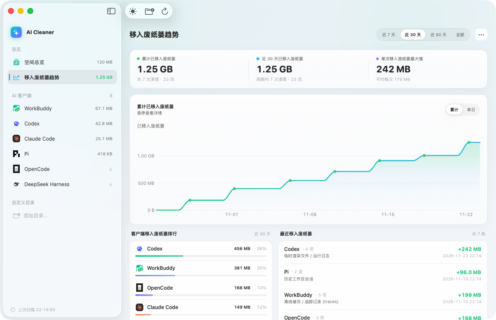

# AI Cleaner

AI Cleaner 的 Tauri 桌面版面向 macOS、Windows 和 Linux，可扫描 31 款 AI 客户端的会话、缓存、日志和临时文件。

## 下载安装

从 GitHub Releases 下载适用于当前系统的安装包。macOS 14.0 或更新版本使用 Universal DMG，将 **AI Cleaner.app** 拖入「应用程序」。Windows x64 使用 NSIS 安装程序（`.exe`）或 MSI。Linux x64 可按发行版选择 DEB、RPM 或 AppImage。各版本页面提供该版本附件的 `SHA256SUMS.txt`。[下载最新版](https://github.com/qiyuanjuzheng/ai-cleaner/releases/latest)

Tauri 版在工具栏提供「检查更新」。macOS、Windows 和 Linux AppImage 用户确认后，客户端会下载并验签安装。Linux DEB 和 RPM 用户会跳转 GitHub Releases 下载新版安装包。

## 界面截图

### 扫描结果


### 移入废纸篓确认


### 清理记录



## 使用流程

1. 打开应用，点击首页居中图标（或使用工具栏扫描按钮 / `⌘R`）开始扫描。扫描结束后，在「空间总览」查看扫描项及占用大小，也可切换到单个客户端。需要刷新结果时点击「重新扫描」。
2. 按类别、时间或清理等级缩小范围，或搜索条目名称、会话标题、摘要、项目或路径。会话行优先显示客户端保存的标题，可点击「查看完整会话标题」查看被截断的文字。需要检查其他文件时，选择「添加自定义目录」，可添加缓存、导出文件或日志所在的文件夹。
3. 可一键勾选建议清理项，在「按需清理」分组头使用「全选本组 / 取消本组」批量勾选历史会话与归档，或逐条勾选需要处理的条目。点击「移入废纸篓」后，核对条目、路径和拟移入的大小，再确认。需要恢复文件时，在 macOS 废纸篓中选择「放回原处」。
4. 在「清理记录」中查看累计、单日和客户端排行。统计仅计入成功移入的条目。查看超过 180 天的全部历史时，非累计图表按周汇总。

## 清理分级

| 等级 | 常见条目 | 如何选择 |
| --- | --- | --- |
| 建议清理 | 缓存、日志、超过 24 小时未修改的 AI 临时文件、更新包 | 「勾选建议清理项」作用于当前客户端或目录。空间总览中的按钮覆盖全部客户端、系统临时目录和自定义目录。 |
| 按需清理 | 聊天会话（含超过 14 天旧会话与归档）、任务产出、快照、可重建索引、24 小时内修改的临时项、`/tmp` 未归属临时项 | 支持在分组头一键「全选本组 / 取消本组」（与搜索和时间筛选联动），也可通过批量菜单全选或反选；24 小时内近期修改的临时项及 `/tmp 未归属临时项` 仍须逐条手动勾选，所有批量勾选操作均会自动跳过它们。 |
| 不建议清理 | 凭据、主数据库、插件、模型权重 | 查看条目旁的保护原因。凭据和主库锁定。可覆盖的插件、模型权重等条目须通过两次风险确认。 |

## 扫描与保护

- 扫描仅读取文件。非压缩 JSONL 会话的头部和尾部各读取最多 64 KB，用于提取标题、项目名和首条提问摘要。Codex 会话及压缩归档也可从本地会话索引读取标题。
- **`/tmp` 分层扫描与仅手选边界**：
  - **第一层（AI 特征精准归属）**：扫描规范化后的 `/private/tmp`（自动解析 `/tmp` 符号链接）与 macOS 用户临时目录（`DARWIN_USER_TEMP_DIR` / `NSTemporaryDirectory()`）中明确带有 AI 客户端或 Agent 命名特征的顶层条目（如 `claude-*`、`claude-desktop*`、`codex-*`、`.com.openai.codex.*`、`com.openai.sky.CUAService`、`opencode*`、`cursor-*`、`windsurf-*`、`com.lbjlaq.antigravity-tools`、`workbuddy-*`、`multica-task-*`、`pi-bash-*.log`、`t3code*`、`magpie-*` 等），优先归入对应已有客户端分组，未单独建组的归入「其他 AI 临时文件（/tmp）」并标注来源标签。超过 24 小时未修改且无活跃占用的条目归为「建议清理」；24 小时内有修改的条目降级为「按需清理（仅手选）」并显示「近期修改」提示。
  - **第二层（`/tmp` 未归属临时项）**：仅扫描 `/private/tmp` 顶层未被第一层命中的当前用户非空普通文件/目录（不混入 `/var/folders/.../T/` 中的无关缓存，自动忽略 `.sboxcache_*` 等隐藏缓存与 0 字节占位），在侧边栏以独立分组「/tmp 未归属临时项」展示，全部强制归为「按需清理（仅手选）」。一键勾选建议清理、全选本组、全选与反选均会跳过这些条目，只能核对路径后逐条手动勾选。
- **活跃进程与通用安全防护**：
  - `/tmp` 扫描严格限定为当前用户拥有（`uid == getuid()`），绝对跳过 `root` 及其他用户的条目；
  - 绝对跳过 Unix Domain Socket（`*.sock`、`S_IFSOCK`）、FIFO、设备节点及特殊符号链接，不展示且在移入废纸篓前双重拦截；
  - 自动跳过当前应用自身、匹配或包含当前运行环境 `TMPDIR` 的目录，以及包含 `.task_lock`、24 小时内近期锁文件或持有活跃 OS 文件锁的目录；
  - 普通和强制清理均保护已知凭据、密钥、登录态目录、客户端主库及其 `-wal`、`-shm`、`-journal` 附属文件，例如 `auth.json`、`Cookies`、`opencode.db`、`thread_history_1.sqlite` 和 `state.vscdb`。移入前会重新检查目标和目录后代。`~/Library/Caches/` 下可重建的 URLCache `Cache.db` 及其附属文件可按缓存规则清理。
  - 系统和敏感目录、`/tmp` 与 `/private/tmp` 根目录、用户主目录、客户端根目录及会话总目录受保护。扫描目录时不会穿透符号链接。所有清理统一调用 macOS 的系统废纸篓接口（`FileManager.trashItem`），绝不执行永久删除。

## 支持的客户端

- **国内客户端**　WorkBuddy（腾讯 WorkBuddy / CodeBuddy）、豆包工作伙伴 / 豆包（Doubao / DoubaoWork）、WorkDaddy、DeepSeek Harness、Trae / Trae CN、Qoder、通义灵码（Lingma）、ZCode / 智谱清言（ChatGLM）、阶跃星辰（StepFun）、Kimi、腾讯元宝。
- **其他客户端**　Claude Code、Codex、Cursor、Windsurf、Claude Desktop、ChatGPT Desktop、OpenCode、Pi、Gemini / Antigravity、Kiro、GitHub Copilot、Multica、Cherry Studio、AnythingLLM、T3 Code、Ollama、LM Studio、Chatbox、Jan、Zed。

## macOS 源码构建环境

- macOS 14.0（Sonoma）或更新版本，Xcode 16 或更新版本（Swift 6+）
- Node.js 22、Rust 1.90 或更新版本，以及 `aarch64-apple-darwin` 和 `x86_64-apple-darwin` Rust 目标

---

## 构建、测试与运行

```bash
# 测试 Swift Core 与 sidecar
swift test

# 构建并打开本地 macOS 通用安装包
(cd apps/desktop && npm ci)
./scripts/build-tauri-macos-assets.sh --tag v1.0.0 --local
open "dist/tauri-local/v1.0.0/AI-Cleaner-v1.0.0-macOS.dmg"
```

如需在隔离目录中运行，解开同版本 ZIP，并通过 `open --env` 将 `AI_CLEANER_HOME` 和 `AI_CLEANER_SYSTEM_TMP` 指向空目录。

```bash
sandbox="$(mktemp -d)"
mkdir "$sandbox/home" "$sandbox/tmp"
ditto -x -k "dist/tauri-local/v1.0.0/AI-Cleaner-v1.0.0-macOS.zip" "$sandbox"
open -n "$sandbox/AI Cleaner.app" --env "AI_CLEANER_HOME=$sandbox/home" \
  --env "AI_CLEANER_SYSTEM_TMP=$sandbox/tmp"
```

内置清理规则定义在 `rules/`。编辑规则后，用装有 `jsonschema==4.23.0` 的 Python 环境运行
`python3 scripts/generate-built-in-rules.py`，并提交生成的 Swift 文件。CI 会校验规则格式和生成结果。

## 后续发版流程

仓库采用 **Release PR 自动发版**。日常合入 `main` 时累计更新日志。成员审阅并合并 Release PR 后，GitHub Actions 创建版本标签、构建三端安装包并发布 GitHub Release。

### 首次启用前必须开启的仓库权限

在 GitHub 仓库中确认开启以下选项，否则工作流无法自动创建 Release PR：

- **Settings → Actions → General → Workflow permissions → 勾选 `Allow GitHub Actions to create and approve pull requests`**

### 日常发版流程（Release PR）

1. **正常合并功能或修复 PR 到 `main`**：`Release PR automation` 工作流（`.github/workflows/release-pr.yml`）会自动扫描自上一个 `vX.Y.Z` 标签以来的未发布改动，在固定分支 `release-pr/main` 上创建或原地更新唯一的 Release PR（标题形如 `chore(release): 发布 v0.2.0`），并累计更新 `CHANGELOG.md`。此阶段**不会**运行耗时的 macOS 编译打包任务。
2. **审阅与可选微调**：合并前可直接在该 Release PR 中编辑 `CHANGELOG.md` 润色中文说明或调整目标版本号。若期间 `main` 继续合入新 PR，工作流会保留你此前对 `CHANGELOG.md` 的手动编辑，并仅增量追加新提交。
3. **合并 Release PR 触发发布**。工作流读取 `CHANGELOG.md` 确认版本，在合并提交上创建标签，再调用 `.github/workflows/release.yml` 构建三端安装包、更新包、`latest.json` 和校验和。所有附件上传到草稿后，工作流发布 GitHub Release 并回帖链接。官网从 GitHub Releases API 读取最新版本。

### 版本号递增规则、手动覆盖与跳过

- **自动推算规则**（兼容 Conventional Commits 与中文 / `AICL-XX` 标题，避免非标准提交静默漏触发）：
  - **主版本（Major，`vX+1.0.0`）**：提交含 `feat!:` / `fix!:`、`BREAKING CHANGE:`、`破坏性变更` / `不兼容变更`，或显式标记 `[release:major]`。
  - **次版本（Minor，`vX.Y+1.0`）**：提交含 `feat:`，或（去除 `AICL-XX` 任务前缀后）以 `新增`、`支持`、`添加`、`增加`、`引入`、`接入`、`实现`、`提供`、`上线`、`add`、`support`、`introduce`、`implement`、`enable` 开头，或显式标记 `[release:minor]`。
  - **修订版本（Patch，`vX.Y.Z+1`）**：`fix:` / `修复` / `恢复` 等修复类提交，以及其余所有应用/构建脚本变更均默认纳入并至少递增 Patch（也可通过 `[release:patch]` 显式指定）。
- **手动覆盖版本号**：
  - 方式一（推荐）：直接编辑 Release PR 中的 `CHANGELOG.md` 顶部版本标题（例如将 `## [v0.2.0] - YYYY-MM-DD` 改为 `## [v0.1.1] - YYYY-MM-DD` 或 `## [v1.0.0] - YYYY-MM-DD`），合并后将以该最终版本号打标并发布。
  - 方式二：在提交或 PR 标题/正文中加入 `[release:major]`、`[release:minor]` 或 `[release:patch]`。
- **跳过自动发版（噪音过滤）**：
  - 仅修改 `site/`、`docs/`、`.github/`、根目录 `*.md`、`LICENSE*`、`.gitignore` 或 Release PR 自身辅助脚本的提交会自动跳过，不触发空发客户端版本。
  - 如需让某次代码提交也不触发或纳入 Release PR，在提交或 PR 标题/正文中加入 `[skip release]` 即可。

### 手动兜底发版与本地打包

- **手动打标签发版**：在已包含对应 `CHANGELOG.md` 章节的 `main` 提交上执行 `git tag -a vX.Y.Z -m "AI Cleaner vX.Y.Z"` 并 `git push origin vX.Y.Z`，将直接触发 `Build and publish AI Cleaner`（`.github/workflows/release.yml`）完成测试、打包与发布。
- **重试发布**：在 GitHub Actions 的 `Build and publish AI Cleaner` 工作流中点击 **Run workflow**（`workflow_dispatch`），输入待发布的 `vX.Y.Z` 标签即可重试构建和发布。修正已发布的安装包时请发新版本。
- **本地预演 Tauri macOS 安装包**。见[构建、测试与运行](#构建测试与运行)。本地打包使用临时 Tauri 更新密钥和 ad-hoc 签名，生成 Universal DMG、ZIP、签名更新包和校验和。
- **下载三端 Tauri 预览包**。在 GitHub Actions 的 `Tauri installer preview` 运行记录中下载构建产物。工作流从各类安装包提取 Swift sidecar 并检查 JSON-RPC 握手。

### 配置发布签名

在 `apps/desktop` 运行 `npm run tauri -- signer generate --write-keys /安全目录/ai-cleaner-updater.key`。将私钥文件内容保存到 Actions Secret `TAURI_SIGNING_PRIVATE_KEY`，将密钥密码保存到 `TAURI_SIGNING_PRIVATE_KEY_PASSWORD`，将 `.pub` 文件内容保存到仓库变量 `TAURI_UPDATER_PUBLIC_KEY`。备份私钥，后续发布继续使用同一密钥。

`v1.0.0` 的 macOS 安装包使用 ad-hoc 签名，Windows 安装包跳过 Authenticode。macOS 首次打开可能需要在「系统设置 → 隐私与安全性」确认。Windows 可能提示未知发布者，启用 Smart App Control 的设备可能拦截安装包。

采用平台证书签名的后续版本需要配置 Apple Developer ID 和公证凭据（`APPLE_CERTIFICATE`、`APPLE_CERTIFICATE_PASSWORD`、`APPLE_SIGNING_IDENTITY`、`APPLE_ID`、`APPLE_PASSWORD`、`APPLE_TEAM_ID`）。Windows 当前的证书导入路径使用 `WINDOWS_SIGN_CERTIFICATE`（Base64 编码的 `.pfx`）和 `WINDOWS_SIGN_CERTIFICATE_PASSWORD`。

正式构建将更新公钥嵌入客户端。发布工作流从签名更新包生成 `latest.json`，应用通过 `releases/latest/download/latest.json` 检查更新，并验证签名与公告版本是否匹配。

---

## 官网

- [AI Cleaner 官网](https://qiyuanjuzheng.github.io/ai-cleaner/)
- 站点源码位于 `site/`。在仓库根目录运行 `python3 -m http.server --directory site` 后，打开 `http://localhost:8000/` 预览。
- GitHub Pages 的发布源为 GitHub Actions。`main` 分支上的站点或发布工作流有变更时自动部署，也可从 Actions 手动运行 `Deploy AI Cleaner website`。
- 站点图标来自 `scripts/generate-icon.swift`。更新图标时，用该脚本生成 PNG，再缩放为 256 × 256，保存到 `site/assets/app-icon.png`。

---

## 项目结构

```text
ai-cleaner/
├── Package.swift                 # Swift Core 与 sidecar 构建目标
├── Sources/
│   ├── AICleanerCore/            # 扫描、规则、安全校验和用户数据存储
│   ├── AICleanerSidecar/         # aicleaner-core 的 JSON-RPC 服务
│   ├── CPlatformSupport/        # 平台系统调用
│   └── CSQLite/                 # 随包构建的 SQLite
├── Tests/                        # Swift Core 和 sidecar 的隔离测试
├── apps/desktop/
│   ├── src/                     # React + TypeScript 桌面界面
│   ├── src-tauri/               # Rust 宿主和应用内更新
│   └── e2e/                     # 桌面端与真实 sidecar 的端到端测试
├── rules/                       # 分平台清理规则
├── protocol/                    # 规则、JSON-RPC 契约与测试夹具
├── scripts/                      # 构建、打包和发布脚本
├── .github/workflows/            # 三端测试、打包与自动发布
└── site/                         # 官网
```
