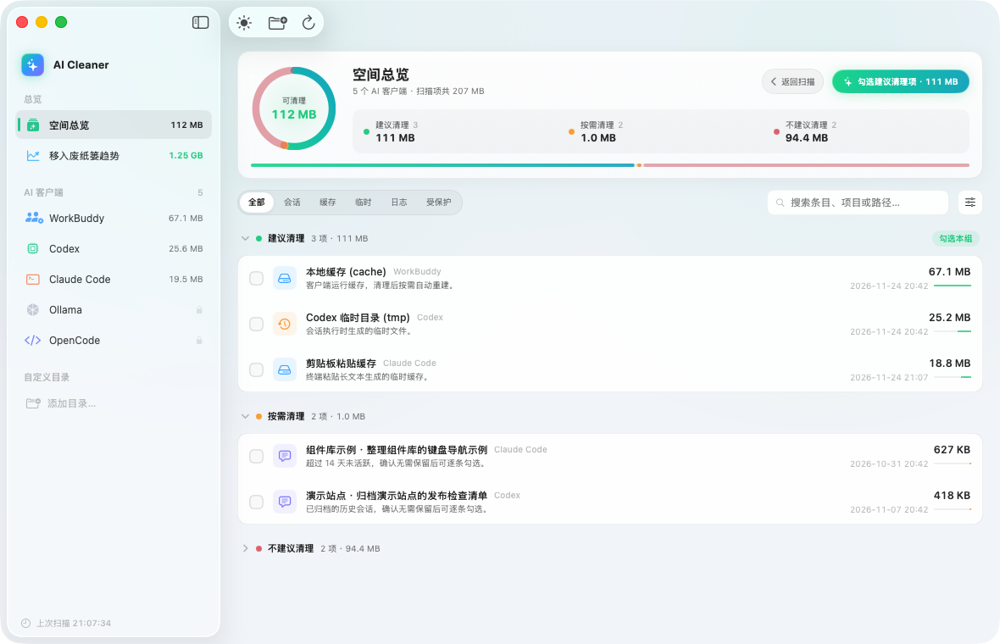
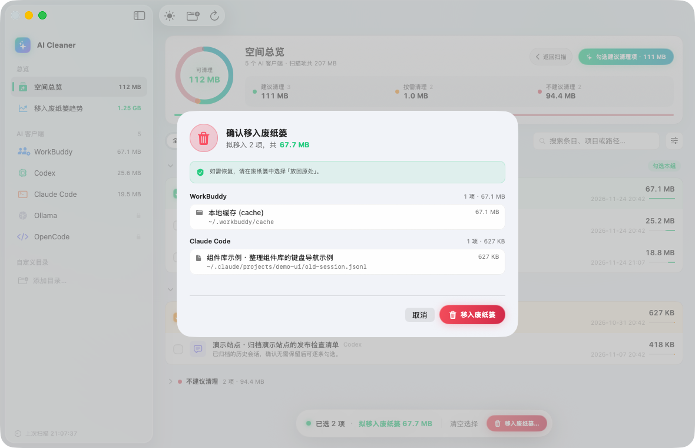

# AI Cleaner

AI Cleaner 是一款 macOS 原生 SwiftUI 应用，可扫描 31 款 AI 客户端的会话、缓存、日志和临时文件。

## 界面截图

### 扫描结果



### 移入废纸篓确认



### 历史趋势


## 使用流程

1. 打开应用，点击「开始扫描」。扫描结束后，在「空间总览」查看扫描项及占用大小，也可切换到单个客户端。需要刷新结果时点击「重新扫描」。
2. 按类别、时间或清理等级缩小范围，或搜索条目名称、会话摘要、项目或路径。需要检查其他文件时，选择「添加自定义目录」，可添加缓存、导出文件或日志所在的文件夹。
3. 批量勾选建议清理项，或逐条勾选需要处理的条目。点击「移入废纸篓」后，核对条目、路径和拟移入的大小，再确认。需要恢复文件时，在 macOS 废纸篓中选择「放回原处」。
4. 在「移入废纸篓趋势」中查看累计、单日和客户端排行。统计仅计入成功移入的条目。查看超过 180 天的全部历史时，非累计趋势按周汇总。

## 清理分级

| 等级 | 常见条目 | 如何选择 |
| --- | --- | --- |
| 建议清理 | 缓存、日志、临时文件、更新包 | 「勾选建议清理项」作用于当前客户端或目录。空间总览中的按钮覆盖全部客户端和自定义目录。 |
| 按需清理 | 聊天会话、任务产出、快照、可重建索引 | 超过 14 天未活跃的会话及归档会话须逐条勾选。建议清理、分组勾选、全选和反选都会跳过它们。 |
| 不建议清理 | 凭据、主数据库、插件、模型权重 | 查看条目旁的保护原因。凭据和主库锁定。可覆盖的插件、模型权重等条目须通过两次风险确认。 |

## 扫描与保护

- 扫描仅读取文件。非压缩 JSONL 会话仅读取开头最多 64 KB，用于提取项目名和首条提问摘要。
- 普通和强制清理均保护已知凭据、密钥、登录态目录、客户端主库及其 `-wal`、`-shm`、`-journal` 附属文件，例如 `auth.json`、`Cookies`、`opencode.db`、`thread_history_1.sqlite` 和 `state.vscdb`。移入前会重新检查目标和目录后代。`~/Library/Caches/` 下可重建的 URLCache `Cache.db` 及其附属文件可按缓存规则清理。
- 系统和敏感目录、用户主目录、客户端根目录及会话总目录受保护。扫描目录时不会穿透符号链接。文件清理调用 macOS 的系统废纸篓接口。

## 支持的客户端

- **国内客户端**　WorkBuddy（腾讯 WorkBuddy / CodeBuddy）、豆包工作伙伴 / 豆包（Doubao / DoubaoWork）、WorkDaddy、DeepSeek Harness、Trae / Trae CN、Qoder、通义灵码（Lingma）、ZCode / 智谱清言（ChatGLM）、阶跃星辰（StepFun）、Kimi、腾讯元宝。
- **其他客户端**　Claude Code、Codex、Cursor、Windsurf、Claude Desktop、ChatGPT Desktop、OpenCode、Pi、Gemini / Antigravity、Kiro、GitHub Copilot、Multica、Cherry Studio、AnythingLLM、T3 Code、Ollama、LM Studio、Chatbox、Jan、Zed。

## 环境要求

- **操作系统**：macOS 14.0 (Sonoma) 或更高版本
- **工具链**：Swift 6.0+ / Xcode 16+

---

## 构建、测试与运行

```bash
# 1. 构建
swift build

# 2. 运行隔离沙箱单元测试（严禁触碰宿主机真实 AI 客户端数据）
swift test

# 3. 直接启动 SwiftUI 桌面应用
swift run AICleanerApp

# 4. 一键打包可双击运行的 macOS .app（输出至 dist/AI Cleaner.app）
./scripts/package-app.sh
open "dist/AI Cleaner.app"
```

> 如需在临时沙箱中预览界面而不扫描真实主目录，可运行：
> `AI_CLEANER_HOME=/path/to/sandbox-home swift run AICleanerApp`

---

## 官网

- [AI Cleaner 官网](https://qiyuanjuzheng.github.io/ai-cleaner/)
- 站点源码位于 `site/`。在仓库根目录运行 `python3 -m http.server --directory site` 后，打开 `http://localhost:8000/` 预览。
- GitHub Pages 的发布源为 GitHub Actions。`main` 分支上的站点或发布工作流有变更时自动部署，也可从 Actions 手动运行 `Deploy AI Cleaner website`。
- 站点图标来自 `scripts/generate-icon.swift`。更新图标时，用该脚本生成 PNG，再缩放为 256 × 256，保存到 `site/assets/app-icon.png`。

---

## 项目结构

```text
ai-cleaner/
├── Package.swift
├── README.md
├── docs/screenshots/                             # macOS 应用界面截图
├── scripts/package-app.sh                        # 打包 dist/AI Cleaner.app 脚本
├── Sources/
│   ├── AICleanerCore/
│   │   ├── Models/                               # CleanupRecommendation / ScanCategory / ScanRule / CleanableItem / CleanupHistoryRecord
│   │   ├── Rules/
│   │   │   ├── BuiltInClientRules.swift          # 国际主流 & 本地大模型客户端规则（20 款）
│   │   │   ├── BuiltInDomesticClientRules.swift  # 国内 AI 客户端与工作伙伴规则（11 款）
│   │   │   └── SafetyGuard.swift                 # 路径、凭据、主数据库与符号链接保护
│   │   └── Services/
│   │       ├── DirectorySizer.swift              # 只读目录体积统计
│   │       ├── SessionMetadataReader.swift       # 只读 JSONL 会话项目与首条提问摘要
│   │       ├── ScanEngine.swift                  # 并发扫描引擎与三档清理分级
│   │       ├── CustomDirectoryStore.swift        # 自定义目录 JSON 持久化
│   │       ├── CleanupHistoryStore.swift         # 移入废纸篓历史统计持久化与聚合
│   │       └── TrashCleaner.swift                # 系统废纸篓移入与清理前复核
│   └── AICleanerApp/
│       ├── AICleanerApp.swift                    # 应用入口与菜单快捷键
│       ├── ViewModels/CleanerViewModel.swift     # 空间总览、分组筛选、勾选与历史状态管理
│       └── Views/                                # 侧边栏、空间总览、分组列表、确认弹窗与趋势图
└── Tests/                                        # 核心逻辑及界面模型的隔离测试
```
