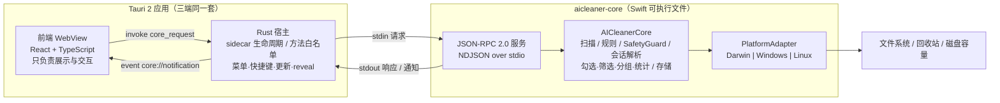

# ADR 0001：三端统一架构（Tauri 2 前端 + Swift 跨平台 Core）

- 状态：已接受（Accepted）
- 日期：2026-11-26
- 关联：AICL-31（总任务）、AICL-32（本 ADR）、AICL-33 ~ AICL-40（落地子任务）
- 影响范围：`Package.swift`、`Sources/AICleanerCore`、新增 sidecar / 平台适配 / Tauri 工程、发布流水线

## 1. 背景

AI Cleaner 目前是 macOS 14+ 的 SwiftUI 应用，代码现状（`origin/main` @ `7a23613`）：

| 模块 | 规模 | 说明 |
| --- | --- | --- |
| `Sources/AICleanerCore` | 约 11.5k 行 | 扫描、规则（31 款客户端，`BuiltInClientRules` + `BuiltInDomesticClientRules` 约 2.2k 行）、`SafetyGuard`、会话解析、zstd 解码、用户数据存储 |
| `Tests/AICleanerCoreTests` | 约 3.7k 行 | Core 测试 |
| `Sources/AICleanerApp` | 约 12.6k 行 | SwiftUI 界面 + `CleanerViewModel`（2.1k 行，含勾选 / 筛选 / 分组等业务规则） |
| 依赖 | Sparkle 2.10.1 | 自动更新，appcast 地址 `releases/latest/download/appcast.xml` |

Core 中与 Apple 平台强绑定的点（AICL-33 会出完整清单，这里列出已确认的）：

- `import Darwin`：`SafetyGuard`、`TempDirectoryScanner`、`FileCleanupSnapshot`、`ScanEngine` 直接调用 `lstat`，读取 `st_uid`、`st_birthtimespec` 等字段，`currentUID: uid_t`。
- `import SQLite3`：`ReadOnlySQLiteReader`。
- `import os`：`OSAllocatedUnfairLock`（`Formatting`、`ScanProgress`、`ScanEngine`）。
- `FileManager.trashItem`（`SystemTrashPerformer`）、`NSTemporaryDirectory()`、`.applicationSupportDirectory`、`volumeAvailableCapacityKey`、`homeDirectoryForCurrentUser`。
- ICU 相关：`DateFormatter`、`localizedCaseInsensitiveCompare`、`localizedStandardCompare`。
- 路径语义：`/private/tmp` 规范化、`raw.hasPrefix("/")` 判断绝对路径、`(path as NSString)` 路径操作、`Bundle.main.bundleIdentifier`（`TempDirectoryScanner` 用它排除自身临时目录）。

AICL-31 已经确定：三端（macOS / Windows / Linux）同时支持，功能与当前 macOS 版对齐；macOS 停用 SwiftUI，三端统一用 Tauri 2；保留 Swift 编写的 Core。本 ADR 记录选型依据，并定下后续子任务要遵守的接口契约。

## 2. 决策摘要

1. **采用方案 A：Swift 跨平台 Core + `aicleaner-core` sidecar（stdio JSON-RPC 2.0）+ Tauri 2 前端。**
2. 所有安全边界和业务规则只在 Core 实现；前端和 Rust 宿主只做展示和转发，不重复实现，也不放宽。
3. 平台差异统一收敛到 `PlatformAdapter`，Core 的其余代码只依赖 FoundationEssentials（目标是去掉 ICU）。
4. 内置规则改为 JSON（schema v1），用平台占位符写路径，**构建时嵌入**二进制，运行时不从外部加载。
5. 用户数据的文件名和格式保持不变；macOS 位置不变；Windows 放 `%LOCALAPPDATA%\AICleaner`，Linux 放 `$XDG_DATA_HOME/aicleaner`。
6. 清理只允许"移入系统回收站"。三端回收站实现都**无法回收时直接失败，不降级为永久删除**。
7. 三端正式版从首个 Tauri 版本开始使用 Tauri updater。macOS 保留 Bundle ID，用户从 GitHub Releases 安装首个 Tauri 版本。**本 ADR 合入即冻结 SwiftUI 代码**，只修 P0。

## 3. 方案对比

| 维度 | **A. Swift Core + Tauri（选定）** | B. Rust 重写 Core + Tauri | C. Swift Core + 各端原生 UI（SwiftUI / WinUI / GTK） | D. Electron |
| --- | --- | --- | --- | --- |
| 原生体验 | 中：WebView UI；macOS 菜单栏 / vibrancy 可通过 Tauri 实现，细节小幅退步 | 中（同 A） | **高**：每端都是原生控件 | 中偏低：Chromium 外观，冷启动慢 |
| 研发成本（1 人全职） | **3.5–4.5 个月**：Core 改造 + 一套前端 | 5.5–7.5 个月：多出 11.5k 行 Core + 3.7k 行测试的重写，以及迁移期两套 Core 并行 | 6–9 个月：Windows 和 Linux 各写一套 UI，Swift 的 WinUI / GTK 绑定还不成熟 | 3.5–4.5 个月（UI 同 A），但 Core 仍需走 sidecar 或改写成 TS |
| 安全规则复用 | **全部复用**（SafetyGuard、/tmp 边界、快照校验） | 需重新实现并重新验证，回归风险最高 | 全部复用 | 复用（Swift sidecar）或重写 |
| 安装包 / 内存（量级预估，以 AICL-33 实测为准） | 前端壳几 MB + Swift 运行时；Windows 随附运行时 DLL，去掉 ICU 后预计几十 MB 以内；闲置内存 = WebView + sidecar | **最小**：单个 Rust 二进制 | 小到中（Windows / Linux 同样要带 Swift 运行时） | **最大**：安装包约 80–120 MB，闲置内存 150 MB 以上 |
| 生态与维护风险 | Swift on Windows / Linux 的 Foundation 成熟度一般（主要风险）；Tauri 2 生态活跃 | Rust 在 Windows API、回收站、Tauri 集成方面生态最好 | 三套 UI 长期维护，功能容易各端走样 | 生态最成熟，体积和内存是硬伤 |
| 可逆性 | **高**：前端只依赖 JSON-RPC 契约，以后换成 Rust Core 不影响前端 | — | 低 | 中 |

**结论：选 A。** 现有 Core 和其中的安全逻辑是项目最值钱的资产，A 是唯一能完整复用这部分、同时只写一套 UI 的方案。B 在体积和生态上更好，但重写的回归风险和工期都高；而且 A 的 JSON-RPC 契约加上协议一致性测试本身就是 B 的迁移通道，需要时可以替换 sidecar 实现，前端不用改。

**重新评估触发条件**（满足任一项时，评估是否切换到 B）：

- AICL-33 实测：Windows 安装包 > 80 MB，或去掉 ICU 不可行且运行时 > 60 MB；
- 三端闲置内存（WebView + sidecar）> 200 MB；
- Swift on Windows 出现阻塞 AICL-35 验收、且两周内无法绕过的 Foundation / 工具链缺陷。

**AICL-33 实测（x64 Windows、x86_64 Linux、arm64 macOS，单位 MiB）**。Windows 和 Linux
原样构建都遇到 Darwin 依赖。兼容探针在 Windows 仍有 11 条编译诊断，Linux 测试通过 68/71，
macOS 原样通过 71/71。

| Tauri 空壳 + Swift 后台进程 | 安装包 | 安装后 | 闲置 RSS / USS |
| --- | --- | ---: | ---: |
| Windows（Swift 占位进程） | NSIS 15.08 / MSI 22.82 | 59.42 | 325.21 / 134.82 |
| Linux（Core 探针，Xvfb） | DEB 24.23 / RPM 24.23 / AppImage 100.99 | 58.47 | 556.13 / 232.80 |
| macOS（Core 探针） | DMG 3.25 | 5.41 | 119.22 / — |

Windows Swift DLL 在完整 Foundation 样本中为 56.24 MiB，在 FoundationEssentials 最小样本中为
13.75 MiB。Linux 静态 musl 的对应样本为 53.45 和 10.25 MiB，完整 Foundation 的 Core 探针为
55.05 MiB。体积数据支持继续当期的规则迁移。评估 200 MB 闲置内存阈值前，需在目标桌面环境用同一
口径复测 WebView 和 Core。Linux CI 中 Core 探针的 USS 为 24.81 MiB。
[实测报告与 CI](https://github.com/qiyuanjuzheng/ai-cleaner/actions/runs/45765556970)。

## 4. 目标架构



### 4.1 仓库布局（Monorepo）

```
Package.swift                     # SwiftPM：Core / Platform / CSQLite / Sidecar
Sources/
  AICleanerCore/                  # 共享业务逻辑和 PlatformAdapter
  CPlatformSupport/               # 平台系统调用
  CSQLite/                        # sqlite amalgamation（C target）
  AICleanerSidecar/               # executable product: aicleaner-core
Tests/
  AICleanerCoreTests/  AICleanerSidecarTests/
protocol/
  rpc-v1.schema.json              # JSON-RPC 方法与 DTO 的 JSON Schema（单一事实来源）
  rules-v1.schema.json            # 规则 JSON schema
  fixtures/                       # 协议一致性测试样例（Swift 与 TS 共用）
apps/desktop/                     # Tauri 2 工程
  src/                            # 前端（React + TS + Vite，列表用 TanStack Virtual）
  src-tauri/                      # Rust 宿主
```

TS 类型由 `protocol/rpc-v1.schema.json` 生成；Swift 端用 `protocol/fixtures` 做编解码一致性测试，避免两边契约漂移。

### 4.2 职责边界

| 层 | 负责 | 不得做 |
| --- | --- | --- |
| AICleanerCore | 规则展开、扫描、SafetyGuard、会话 / 项目解析、勾选与批量勾选规则、筛选 / 搜索 / 分组 / 排序 / 统计 / 推荐、清理执行前复核、用户数据读写 | 直接调用平台 API、格式化日期或本地化文本 |
| PlatformAdapter | 路径与占位符解析、文件身份（不穿透链接）、回收站、磁盘容量、临时目录、当前用户身份 | 做业务判断（是否允许清理由 Core 决定） |
| aicleaner-core | 协议编解码、会话状态（扫描结果、勾选集）、并发与取消、空闲退出 | 绕过 Core 直接操作文件 |
| Rust 宿主 | 启动 / 重启 sidecar、方法白名单转发、单实例、原生菜单 / 快捷键、更新、"在 Finder / 资源管理器中显示" | 接受前端传入的任意路径去执行文件操作 |
| 前端 | 渲染、交互、日期 / 数字本地化格式、清理记录图表的日 / 周汇总 | 实现或放宽任何安全规则；自行判断条目能否勾选或清理 |

## 5. PlatformAdapter 协议

`AICleanerCore/Platform` 维护协议、值类型和 `HostPlatformAdapter`。需要 C 接口的系统调用由 `CPlatformSupport` 提供。Core 的构造入口注入 adapter，测试使用 `SandboxPlatformAdapter`。

```swift
public enum PlatformKind: String, Codable, Sendable { case macos, windows, linux }

public enum PathPlaceholder: String, CaseIterable, Sendable {
    case home, tmp                                   // 三端
    case appSupport, caches, logs                    // macOS
    case appData, localAppData                       // Windows
    case xdgConfig, xdgCache, xdgData                // Linux
}

public enum Principal: Hashable, Sendable {
    case uid(UInt32)        // macOS / Linux
    case sid(String)        // Windows，例如 "S-1-5-21-…"
}

public enum FileKind: Hashable, Sendable {
    case regular, directory
    case symlink                          // POSIX 符号链接 / Windows 符号链接
    case reparsePoint(tag: UInt32)        // Windows junction、挂载点、云文件占位符等
    case fifo, socket, device, other
}

public struct FileIdentity: Hashable, Sendable {
    public let kind: FileKind
    public let owner: Principal?
    public let volumeID: UInt64           // st_dev / VolumeSerialNumber
    public let fileID: UInt64             // st_ino / FileIndex（Windows 可扩展为 128 位）
    public let size: Int64
    public let modifiedAt: Date
    public let changedAt: Date?           // ctime；Windows 用 ChangeTime
    public let createdAt: Date?           // birthtime；Linux 用 statx 读，读不到为 nil
    public let isHiddenOrSystem: Bool     // Windows FILE_ATTRIBUTE_HIDDEN|SYSTEM；POSIX 恒为 false
}

public struct DiskCapacity: Sendable { public let total: Int64; public let available: Int64 }

public struct TemporaryRoots: Sendable {
    public let shared: URL?   // macOS /private/tmp；Linux /tmp；Windows nil（%SystemRoot%\Temp 不扫描）
    public let user: URL      // macOS DARWIN_USER_TEMP_DIR；Windows GetTempPath2W；Linux $TMPDIR 或 /tmp
}

public enum TrashOutcome: Sendable {
    case trashed(location: URL?)          // 回收站中的新位置（拿不到时为 nil）
}

public protocol PlatformAdapter: Sendable {
    var platform: PlatformKind { get }
    var homeDirectory: URL { get }
    var currentPrincipal: Principal { get }
    /// AI Cleaner 自身的标识（Bundle ID / 进程名前缀），扫描临时目录时用来排除自己。
    /// 替代 `Bundle.main.bundleIdentifier`：sidecar 进程里拿不到宿主的 Bundle ID。
    var selfIdentifiers: [String] { get }

    func resolve(_ placeholder: PathPlaceholder) -> URL?   // 当前平台不支持时返回 nil
    func userDataDirectory() -> URL
    func temporaryRoots() -> TemporaryRoots

    /// 读取文件身份，绝不穿透符号链接 / reparse point。
    func identity(at url: URL) throws -> FileIdentity
    func diskCapacity(for url: URL) -> DiskCapacity?

    /// 移入系统回收站。无法回收时必须抛 `TrashError.unavailable`，绝不降级为永久删除。
    func moveToTrash(_ url: URL) throws -> TrashOutcome

    /// 路径比较语义：macOS 按 APFS 默认不区分大小写；Windows 不区分；Linux 区分。
    var pathsAreCaseInsensitive: Bool { get }
}
```

### 5.1 各平台实现要点

| 能力 | macOS | Windows | Linux |
| --- | --- | --- | --- |
| 文件身份 | `lstat`（沿用现有逻辑） | `CreateFileW(FILE_FLAG_OPEN_REPARSE_POINT \| FILE_FLAG_BACKUP_SEMANTICS)` + `GetFileInformationByHandle(Ex)`；`GetSecurityInfo` 读 owner SID；`FILE_ATTRIBUTE_REPARSE_POINT` 时读 reparse tag | `statx(AT_SYMLINK_NOFOLLOW)`，取不到时回退 `lstat` |
| "属于当前用户" | `st_uid == getuid()` | owner SID 等于当前进程 token 的用户 SID | `st_uid == getuid()` |
| 回收站 | `FileManager.trashItem` | `IFileOperation` + `FOFX_RECYCLEONDELETE \| FOF_ALLOWUNDO \| FOF_NOCONFIRMATION \| FOF_NOERRORUI \| FOF_SILENT`；用 `IFileOperationProgressSink::PreDeleteItem` 检查，**未带 `TSF_DELETE_RECYCLE_IF_POSSIBLE` 时返回 `E_ABORT`**；执行前用 `GetDriveTypeW` / `SHQueryRecycleBinW` 排除网络盘、可移动盘 | freedesktop Trash 规范：home trash `$XDG_DATA_HOME/Trash`，其他挂载点用 `$topdir/.Trash/$uid`（校验 sticky 位且非符号链接）或 `$topdir/.Trash-$uid`；先用 `O_EXCL` 写 `.trashinfo`，再 `rename(2)`；**跨设备时直接失败**，不走"复制 + 删除" |
| 磁盘容量 | `volumeAvailableCapacityKey` | `GetDiskFreeSpaceExW` | `statvfs` |
| 临时目录 | `/private/tmp` + `DARWIN_USER_TEMP_DIR` | `GetTempPath2W`（仅当前用户） | `/tmp` + `$TMPDIR` |
| 用户数据目录 | `~/Library/Application Support/AICleaner` | `%LOCALAPPDATA%\AICleaner` | `${XDG_DATA_HOME:-~/.local/share}/aicleaner` |

### 5.2 Core 侧必须同步调整的点

- 路径规范化（`ExcludedItemMatcher.normalizePath`、`SafetyGuard.normalizePath`、`normalizeTempPath`）改为平台感知：Windows 分隔符、盘符、`\\?\` 长路径前缀，比较时遵循 `pathsAreCaseInsensitive`。
- `SessionProjectEvidence.workspacePath` 不能再用 `hasPrefix("/")` 判断绝对路径，Windows 会话里记录的是 `C:\…`。
- `FileCleanupSnapshot` 改用 `FileIdentity`；取不到 birthtime 的平台用 `(volumeID, fileID, ctime)` 判断文件是否被替换。
- 锁：`OSAllocatedUnfairLock` 换成 `Synchronization.Mutex`；日志用 swift-log，输出到 stderr。
- 去 ICU：`DateFormatter` 移到前端；名称排序改为不依赖 ICU 的"大小写不敏感 + 数字自然序"比较（中文名称不再按拼音排序，属于可接受的变化，在 AICL-36 测试里固定下来）；`NSString` 路径操作换成 `URL` / `FilePath`。
- `SystemTrashPerformer` 变成 `PlatformAdapter.moveToTrash` 的薄封装，`TrashPerforming` 保留为测试注入点。

## 6. sidecar JSON-RPC 契约（协议 v1）

### 6.1 传输

- JSON-RPC 2.0，**NDJSON over stdio**：一行一个 UTF-8 JSON 对象，以 `\n` 结尾；stdout 只输出协议消息，日志一律写 stderr。
- 数值：字节数、文件数是 JSON 整数（< 2^53，前端可以安全使用 `number`）。时间是 ISO 8601 UTC 字符串（`2026-11-26T04:01:29Z`）。路径是当前平台的原生绝对路径字符串。
- 请求可以并发发出。会修改状态的方法在 sidecar 内部按顺序执行（actor）。扫描在后台任务里跑，不阻塞查询。
- **会话状态**：扫描结果（`scanId`）和勾选集都放在 sidecar 内存里，前端只持有 ID 和版本号。

### 6.2 版本协商

- 第一个请求必须是 `core.handshake`。`protocolVersion` 采用 `major.minor`：major 不同就拒绝（`-32000`）；minor 只做增量扩展，靠 `capabilities` 告诉对方支持哪些新能力。
- 前端和 sidecar 一起打包发布，版本不一致只会出现在开发环境或安装损坏的情况下；宿主收到 `-32000` 后提示用户"安装不完整，请重新安装"。

### 6.3 一致性与防误删

- `reportRevision`：扫描结果每变化一次（完成、移入回收站、排除、恢复）就加 1。
- `selectionRevision`：勾选集每变化一次就加 1。
- `trash.preview` 根据当前勾选生成确认清单和 `confirmationToken`（绑定 `scanId + reportRevision + selectionRevision + 条目 ID 集`）。`trash.execute` 只接受这个 token，任意一项变了就返回 `-32006`，前端必须重新展示确认清单。
- `trash.execute` 执行时，Core 对每个条目重新做 `SafetyGuard.validateTargetRecursively`，并用 `FileCleanupSnapshot` 对比扫描时的状态（保持现有行为）。**删除类方法只接受 Core 自己扫描出来的条目 ID，不接受路径。**

### 6.4 方法清单

| 方法 | params | result / 说明 |
| --- | --- | --- |
| `core.handshake` | `{protocolVersion, clientVersion, locale}` | `{protocolVersion, coreVersion, platform, capabilities[]}` |
| `core.ping` | `{}` | `{}`；窗口可见时前端每 60 s 发一次，用来续期空闲计时 |
| `core.shutdown` | `{}` | `{}`；发送响应后退出 |
| `scan.start` | `{}`（自定义目录、排除项由 Core 从存储读取） | `{scanId}`；同一时间只允许一个扫描，已有扫描在跑时返回 `-32001` |
| `scan.cancel` | `{scanId}` | `{}`；扫描以 `scan.completed{status:"cancelled"}` 结束 |
| 通知 `scan.progress` | — | `{scanId, stage, clients[], scannedFileCount, cleanableBytes}`，字段对应现有 `ScanProgressEvent`，节流 ≥ 150 ms |
| 通知 `scan.completed` | — | `{scanId, status: "completed"\|"cancelled"\|"failed", reportRevision, summary, error?}` |
| `report.summary` | `{scanId}` | 总量、各分组（`recommendation`）计数与体积、`detectedBuiltInClientsCount` 等（对应 `ScanReport` 顶层字段） |
| `clients.list` | `{scanId}` | 侧栏用的客户端列表：`{id, name, symbolName, accentToken, kind, totalSizeBytes, recommendedSizeBytes, …}` |
| `items.query` | `{scanId, scope, filter, sort, offset, limit}` | `{reportRevision, total, groups[], items[]}`，用于虚拟滚动分页；`groups` 带每组的计数、体积、全选状态 |
| `items.get` | `{scanId, ids[]}` | `{items[]}`（例如查看完整会话标题） |
| `selection.apply` | `{scanId, op, scope?, filter?, itemIds?, recommendation?}` | `{selectionRevision, selectedCount, selectedBytes, hasNotRecommended}` |
| `selection.confirmRisk` | `{scanId, itemId}` | 同上；"不建议清理"的条目必须先调这个方法才能被勾选 |
| `trash.preview` | `{scanId}` | `{confirmationToken, items[], totalBytes, hasNotRecommended}` |
| `trash.execute` | `{scanId, confirmationToken, acknowledgedNotRecommendedRisk}` | `{result: CleanupResult, reportRevision, historyRecord?}`；单个条目的失败放在 `result` 里，不作为 RPC 错误返回 |
| `history.list` | `{}` | `{records[]}`（`CleanupHistoryRecord`，按时间正序）；按日 / 周汇总由前端按本地时区计算 |
| `history.delete` / `history.clear` | `{id}` / `{}` | `{}` |
| `excluded.list` | `{}` | `{records[], statuses}` |
| `excluded.add` | `{scanId, itemId}` | `{record, reportRevision}` |
| `excluded.restore` / `excluded.restoreAll` | `{id}` / `{}` | `{}`；之后前端可以触发重新扫描 |
| `customDirs.list` | `{}` | `{directories[]}` |
| `customDirs.validate` | `{path}` | `{allowed, reason?}`（`SafetyGuard.validateCustomDirectoryRoot`） |
| `customDirs.add` / `customDirs.remove` | `{path, displayName?, category?, mode?}` / `{id}` | `{directory}` / `{}` |
| `projects.list` | `{scanId, clientId?, includeAllClients}` | `{projects[]}`：`{projectId, name, workspacePath?, sessionCount, sizeBytes, isProtected}` |
| `projects.sessions` | `{scanId, projectId, filter, sort, offset, limit}` | 返回结构同 `items.query`，并附带每个会话的关联产物 |
| `projects.setProtection` | `{projectId, enabled}` | `{isProtected}` |
| `disk.capacity` | `{}` | `{total, available}` |
| `settings.get` / `settings.set` | `{}` / `{appearanceMode}` | `{appearanceMode}` |
| `items.resolvePath` | `{scanId, itemId}` | `{path}`；**只给 Rust 宿主用**（在 Finder / 资源管理器中显示、复制路径），不在前端白名单里 |

`scope` / `filter` / `sort` / `op` 的取值（从 `CleanerViewModel` 迁到 Core，AICL-36 实现）：

```jsonc
// scope
{ "kind": "all" } | { "kind": "client", "clientId": "codex" } | { "kind": "clientProjects", "clientId": "claude-code", "projectId": "…" }
// filter
{ "search": "string", "category": "sessions|cache|temporary|logs|custom|protectedData|null",
  "recommendation": "recommended|reviewSuggested|notRecommended|null",
  "age": "all|olderThan7Days|olderThan30Days|olderThan90Days" }
// sort
"sizeDesc" | "sizeAsc" | "modifiedDesc" | "modifiedAsc" | "nameAsc"
// selection op
"toggle" | "selectRecommendedInScope" | "selectSection" | "deselectSection" | "toggleSection"
| "selectAllVisible" | "invertVisible" | "clearVisible" | "clearAll"
```

批量勾选规则只在 Core 里实现：跳过 24 小时内修改的临时项、`/tmp` 未归属项、`requiresIndividualSelection` 和 `notRecommended` 条目。前端只根据条目的 `bulkSelectable` / `selected` 字段渲染。

`ItemDTO` 字段：`id, clientId, clientName, ruleId, displayName, preferredTitle, sessionTitle?, sessionProjectName?, fileName, path, category, recommendation, safetyNote, hardProtectionReason?, requiresIndividualSelection, bulkSelectable, selected, sourceBadge?, isRecentlyModified, isSessionArtifact, isDirectory, isCustom, sizeBytes, fileCount, modifiedAt`。

### 6.5 错误码

标准码：`-32700` 解析错误、`-32600` 无效请求、`-32601` 方法不存在、`-32602` 参数无效、`-32603` 内部错误。

| code | 名称 | 场景 |
| --- | --- | --- |
| -32000 | `PROTOCOL_VERSION_MISMATCH` | major 版本不一致 |
| -32001 | `SCAN_IN_PROGRESS` | 已有扫描在进行 |
| -32002 | `SCAN_NOT_FOUND` | `scanId` 不存在（sidecar 重启或空闲退出后），前端提示重新扫描 |
| -32003 | `SCAN_NOT_READY` | 扫描还没完成就查询结果 |
| -32004 | `STALE_REVISION` | 传入的 revision 已过期 |
| -32005 | `RISK_CONFIRMATION_REQUIRED` | 勾选或清理"不建议清理"条目前没有完成风险确认 |
| -32006 | `CONFIRMATION_TOKEN_INVALID` | 确认清单生成后结果或勾选发生了变化 |
| -32010 | `SAFETY_BLOCKED` | 被 SafetyGuard 拦截，`data.reason` 是中文原因 |
| -32011 | `INVALID_PATH` | 路径不存在、不是绝对路径或格式非法 |
| -32012 | `TRASH_UNAVAILABLE` | 目标所在卷不支持回收站 |
| -32020 | `STORAGE_IO_ERROR` | 用户数据读写失败 |
| -32021 | `STORAGE_CORRUPT` | 用户数据文件无法解析（见 7.3） |
| -32030 | `NOT_SUPPORTED_ON_PLATFORM` | 当前平台不支持该能力 |

`error.data` 统一为 `{ "name": "SAFETY_BLOCKED", "reason"?: string, "itemId"?: string, "path"?: string }`。

### 6.6 生命周期

- 由 Rust 宿主按需启动（Tauri `externalBin`）。sidecar 在 stdin EOF（宿主退出或崩溃）时立即退出。
- 空闲超时：10 分钟内没有任何请求、也没有扫描在跑，就退出。窗口可见时前端每 60 s 发一次 `core.ping`，所以只有应用长时间隐藏或驻留后台时才会退出。宿主在下一次请求时自动重新拉起；前端收到 `SCAN_NOT_FOUND` 后提示重新扫描。
- 单实例：Tauri `single-instance` 插件，再加上 sidecar 在用户数据目录持有 `core.lock`（`flock` / `LockFileEx`），避免两个进程同时写数据。
- 宿主只转发白名单方法；前端没有 fs 插件，也没有执行任意 shell 命令的能力；CSP 禁止远程内容。

## 7. 用户数据存储与兼容

### 7.1 位置与文件

| 文件 | 内容 | 现有格式（保持不变） |
| --- | --- | --- |
| `cleanup-history.json` | 清理记录 | `[CleanupHistoryRecord]`，ISO 8601 日期 |
| `custom-directories.json` | 自定义目录 | `[CustomScanDirectory]`，ISO 8601 日期 |
| `excluded-items.json` | 排除项 | `[ExcludedItemRecord]`，ISO 8601 日期 |
| `protected-projects.json` | 项目保护 | `[String]`（已排序） |
| `settings.json`（新增） | 外观等设置 | `{ "appearanceMode": "light" \| "dark" \| "system" }` |

目录：macOS `~/Library/Application Support/AICleaner/`（**不变**）；Windows `%LOCALAPPDATA%\AICleaner\`（不用 Roaming：排除项和自定义目录都是本机路径，跟着漫游配置同步到别的机器反而出错）；Linux `${XDG_DATA_HOME:-~/.local/share}/aicleaner/`。

**用户数据只由 Core 写入。** Tauri 的 `app_data_dir` 按 Bundle ID 命名（`com.qiyuanjuzheng.ai-cleaner`），和现有目录不同，不用它存业务数据。WebView 的 localStorage 只存可以丢的纯界面状态（例如分组折叠状态）。

### 7.2 兼容规则

- 字段只增不删、不改名；新增字段必须可选，解码时有默认值（沿用 `AIClientProfile.init(from:)` 里 `decodeIfPresent` 的做法）。
- 写入一律走"临时文件 + 原子 rename"。
- 外观设置迁移：macOS 首次启动时，sidecar 通过 `UserDefaults(suiteName: "com.qiyuanjuzheng.ai-cleaner")` 读取 `aiCleaner.appearanceMode.v2`，写进 `settings.json`。只读，不删除原值。
- 不支持降级回 SwiftUI 版。不过由于字段只增不删，旧版仍然能读这些文件。

### 7.3 损坏文件处理（修复现有风险）

现在的 `load()` 遇到解析失败会静默返回 `[]`，下一次写入就会**覆盖**用户原有数据。改为：解析失败时把原文件 rename 为 `<name>.corrupt-<UTC 时间戳>.json` 保留下来，再从空数据开始，同时返回或记录 `STORAGE_CORRUPT`，前端提示一次。AICL-35 / AICL-36 要补对应测试。

## 8. 规则 JSON schema（v1）

### 8.1 结构

```jsonc
{
  "$schema": "../../protocol/rules-v1.schema.json",
  "schemaVersion": 1,
  "templates": {
    "electronCache": {
      "params": ["prefix", "root", "includeCachedData"],
      "rules": [
        { "id": "{{prefix}}-cache", "displayName": "应用网络缓存 (Cache)", "path": "{{root}}/Cache",
          "category": "cache", "mode": "directory", "recommendation": "recommended",
          "explanation": "应用静态资源与网络缓存，清理后按需自动重建，不影响登录。" }
        // … Code Cache / GPUCache / Crashpad 等，与 standardElectronCacheRules 一一对应
        // includeCachedData 为 true 时追加的规则用 "when": "{{includeCachedData}}"
      ]
    }
  },
  "profiles": [
    {
      "id": "codex", "name": "Codex", "symbolName": "…", "accentToken": "codex",
      "description": "…", "protectedSummary": "…",
      "platforms": ["macos", "windows", "linux"],
      "rules": [
        { "id": "codex-sessions", "displayName": "…", "path": "{home}/.codex/sessions",
          "category": "sessions", "mode": "recursiveFiles", "allowedFileSuffixes": [".jsonl", ".jsonl.zst"],
          "explanation": "…" },
        { "use": "electronCache", "platforms": ["macos"],
          "with": { "prefix": "codex-desktop", "root": "{appSupport}/Codex", "includeCachedData": false } },
        { "use": "electronCache", "platforms": ["windows"],
          "with": { "prefix": "codex-desktop", "root": "{appData}/Codex", "includeCachedData": false } },
        { "id": "codex-protected-thread-db", "protected": true, "displayName": "主对话索引库 (thread_history_1.sqlite)",
          "path": "{home}/.codex/thread_history_1.sqlite", "explanation": "…" }
      ]
    }
  ]
}
```

- 规则字段与现有 `ScanRule` 一一对应：`id, displayName, path, category, mode, recommendation?, explanation, allowedFileSuffixes?, isSessionArchive?`。`recommendation` 省略时按 `category` 推导，规则与现有 `ScanRule.init` 一致。`protected: true` 等价于现有的 `protectedRule(...)`。
- `platforms` 可以写在 profile 和 rule 上，rule 上的会覆盖 profile 上的；不写表示三端都适用。
- 同一条规则在不同平台路径不同时，可以用 `paths` 替代 `path`：`{"macos": "…", "windows": "…", "linux": ["{xdgConfig}/X", "{home}/.var/app/com.x.X/config/X", "{home}/snap/x/current/.config/X"]}`，Linux 允许多个候选路径（原生 / Flatpak / Snap）。
- 规则 ID 全局唯一，并且**与现有 Swift 规则 ID 保持一致**：排除项、清理记录和快照测试都依赖这些 ID。

### 8.2 占位符

| 占位符 | macOS | Windows | Linux |
| --- | --- | --- | --- |
| `{home}` | `~` | `%USERPROFILE%` | `$HOME` |
| `{appSupport}` | `~/Library/Application Support` | — | — |
| `{caches}` | `~/Library/Caches` | — | — |
| `{logs}` | `~/Library/Logs` | — | — |
| `{appData}` | — | `FOLDERID_RoamingAppData` | — |
| `{localAppData}` | — | `FOLDERID_LocalAppData` | — |
| `{xdgConfig}` | — | — | `${XDG_CONFIG_HOME:-~/.config}` |
| `{xdgCache}` | — | — | `${XDG_CACHE_HOME:-~/.cache}` |
| `{xdgData}` | — | — | `${XDG_DATA_HOME:-~/.local/share}` |
| `{tmp}` | 用户临时目录 | 用户临时目录 | 用户临时目录 |

### 8.3 校验（加载时 + CI）

- 路径必须以占位符开头；禁止 `..`、禁止绝对路径、禁止 `~`；正斜杠为统一分隔符，由 adapter 转成平台分隔符。
- 规则声明的平台上必须能解析其占位符（例如 `{appData}` 不能出现在声明了 `macos` 的规则里），否则 schema 校验失败。
- 展开后的路径必须通过 `SafetyGuard.validateBuiltInContainer`，不通过的规则直接丢弃并写日志，不能让扫描崩溃。
- 模板参数必须全部提供；展开后规则 ID 不能重复。
- **规则在构建时嵌入**：JSON 是唯一事实来源，生成脚本把它转成 Swift 源码嵌入 Core，CI 检查生成结果是否最新。不用 SwiftPM 运行时资源 bundle（Windows / Linux 打包时容易漏），也不加载外部规则文件：规则决定了哪些文件会被移入回收站，外部可写的规则文件就是一个攻击面。v1 不支持远程更新规则，也不支持用户自定义规则包。

## 9. 永久删除禁令的工程化保证

- Core / Platform / Sidecar 源码在 CI 中做 lint：禁止出现 `removeItem(`、`unlink(`、`rmdir(`、`remove(`、`DeleteFileW`、`RemoveDirectoryW`、`SHFileOperation`。白名单只包括：用户数据原子写入的临时文件清理、Linux `.trashinfo` 写入失败后的回滚。白名单文件写在 lint 配置里。
- 三端各有测试：用不支持回收站的卷或模拟 adapter，断言结果是 `TRASH_UNAVAILABLE`，并且源文件仍然存在。
- sidecar 集成测试：在沙箱 home 中完整跑一遍"扫描 → 勾选 → 预览 → 执行"，断言文件出现在回收站（macOS 废纸篓 / Windows `$Recycle.Bin` / 沙箱 `XDG_DATA_HOME/Trash`），原位置不再存在。

## 10. 打包、签名与更新

### 10.1 构建产物

| 平台 | 安装包 | sidecar | 最低系统 |
| --- | --- | --- | --- |
| macOS | `.dmg` + `.app.tar.gz`（Tauri updater） | universal（arm64 + x86_64 用 `lipo` 合并），放在 `Contents/MacOS/aicleaner-core` | macOS 14.0（与现版一致） |
| Windows | NSIS `.exe`（同时提供 MSI） | `aicleaner-core.exe` + Swift 运行时 DLL（同目录） | Windows 10 1809+（WebView2 Evergreen） |
| Linux | `.deb`、`.rpm`、`.AppImage` | 静态 musl（Static Linux SDK）优先；不可行时用动态链接 + 随包运行时 | webkit2gtk-4.1（Ubuntu 22.04+ / Debian 12+ / Fedora 38+） |

### 10.2 安装包与更新签名

- **macOS**：应用和 sidecar 一起使用 ad-hoc 签名。CI 用 `codesign --verify --deep --strict` 校验两者的签名结构。完全磁盘访问权限（TCC）按发起访问的应用来认定，授予 `.app` 后对它启动的 sidecar 同样生效。
- **Windows**：NSIS 和 MSI 跳过 Authenticode。
- **Linux**：`.deb` / `.rpm` 附带 SHA-256 校验和；AppImage 的更新包由 Tauri updater 签名。
- **Tauri updater**：使用项目专用的 minisign 密钥（`TAURI_SIGNING_PRIVATE_KEY`）。应用内置公钥，并校验更新包签名及签名绑定的版本。

发布任务用正式 Tauri 更新公钥验证三端更新包，校验通过后生成 `latest.json`。

### 10.3 Tauri 更新

AICL-40 确认旧版没有在用用户。首个 Tauri 正式版由用户从 GitHub Releases 安装。应用内「检查更新」使用 `https://github.com/qiyuanjuzheng/ai-cleaner/releases/latest/download/latest.json`，覆盖 macOS arm64 和 x64、Windows x64 的 NSIS 和 MSI，以及 Linux x64 AppImage。DEB 和 RPM 用户通过应用内提示跳转下载页。

验收用同一组测试密钥构建两个 Tauri 版本，验证前一版能发现更新、拒绝版本与签名不匹配的更新包、安装有效更新并重启。macOS 保留 `CFBundleIdentifier = com.qiyuanjuzheng.ai-cleaner` 和 `LSMinimumSystemVersion = 14.0`。

### 10.4 SwiftUI 冻结与移除时间点

| 时间点 | 条件 | 动作 |
| --- | --- | --- |
| T0：本 ADR 合入 main | — | `Sources/AICleanerApp` 冻结，只接受 P0 修复（数据丢失、误删、崩溃、无法启动）；新功能只做在 Core 和 Tauri 前端 |
| T1：阶段 3 完成 | AICL-39 功能对照表全部勾完，三端 E2E 通过 | 从 GitHub Actions 下载 Tauri 预览安装包 |
| T2：阶段 4 首个正式版 | `v1.0.0` 三端安装包与 Tauri 更新链路验证通过 | 发布三端正式安装包和 `latest.json` |
| T3：清理旧客户端源码 | 首发后由维护者确认 | 删除 `Sources/AICleanerApp`、`Tests/AICleanerAppTests` 和 Sparkle 依赖，继续兼容旧版用户数据 |

## 11. 测试策略

- **Core**：`swift test` 在 macOS / Windows / Linux 三端 CI 上运行（AICL-35 验收）；原 `CleanerViewModelTests` 中的业务用例迁到 Core（AICL-36）。
- **规则**：JSON 化前后，在同一测试沙箱里的扫描结果快照必须完全一致（AICL-34 验收）。
- **协议**：`protocol/fixtures` 做 Swift 与 TS 双向编解码测试；sidecar 集成测试覆盖握手、进度通知、取消、revision 过期、token 失效、错误码。
- **前端**：单元测试覆盖渲染逻辑和图表汇总；三端 E2E（WebDriver / tauri-driver）用沙箱 home 跑完整流程。
- **安全**：见第 9 节；每个平台的 SafetyGuard 受保护名单都要有对应测试（AICL-37 / AICL-38）。

## 12. 风险与待验证项

| 风险 / 问题 | 影响 | 验证 / 处理 | 负责 issue |
| --- | --- | --- | --- |
| Windows 上 Swift Foundation 的 `FileManager` / `URL` 行为差异 | 扫描结果不一致 | 三端跑同一套 Core 测试；遇到差异时 adapter 直接调用 Win32 API | AICL-33 / 35 |
| 只用 FoundationEssentials 不可行（`NSString`、`Bundle`、`TimeZone` 等缺失） | 体积达不到目标 | 先出缺失 API 清单再逐项替换；实在不行就接受带 ICU，并按第 3 节的触发条件重新评估 | AICL-33 / 35 |
| Windows `IFileOperation` 在大文件或回收站满时的行为 | 可能出现永久删除 | 用 `PreDeleteItem` 拦截加专项测试；不满足条件一律 `TRASH_UNAVAILABLE` | AICL-35 |
| 5,000+ 条目分页查询的延迟 | 列表滚动卡顿 | `items.query` 单页 200 条，目标 P95 < 30 ms；必要时前端预取 | AICL-36 / 39 |
| macOS 原生细节退步（菜单栏、vibrancy、动效） | 体验下降 | AICL-39 的对照表逐项验收，已明确接受小幅退步 | AICL-39 |
| 正式更新元数据与安装包的版本不一致 | 客户端无法安装新版 | 更新签名绑定版本，发布前校验产物，使用两个 Tauri 版本做覆盖升级演练 | AICL-40 |
| 体积和内存的实际数字 | 估算可能偏差 | 以 AICL-33 实测为准，结果回填本 ADR 第 3 节 | AICL-33 |

## 13. 落地顺序

1. **阶段 1**：本 ADR（AICL-32）+ 三端编译与体积实测（AICL-33）。
2. **阶段 2**：规则 JSON 化（AICL-34）→ PlatformAdapter 与去平台依赖（AICL-35）→ 业务逻辑下沉 Core + sidecar（AICL-36）。
3. **阶段 3**：Windows / Linux 规则与 SafetyGuard（AICL-37 / 38）+ Tauri 前端功能对齐（AICL-39）。
4. **阶段 4**：启用 Tauri 更新、发布三端安装包，随后移除 SwiftUI（AICL-40）。

本 ADR 中的契约（PlatformAdapter、RPC v1、规则 schema v1、存储位置）如果需要做破坏性修改，必须新增 ADR 或修订本文并说明原因；增量扩展（新方法、新可选字段、新占位符）在对应子 issue 中记录即可。
